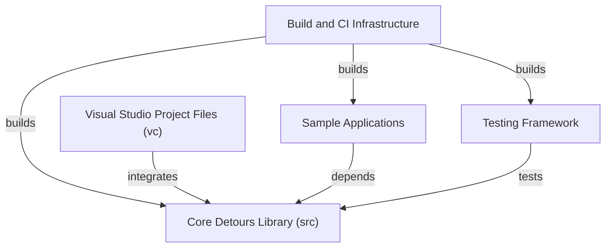

# microsoft/Detours

> Microsoft C++ library for intercepting and instrumenting API calls on Windows, aimed at systems developers.

## The problem
Observing or changing the behavior of a Windows program without touching its source code forces you to hack together fragile binary patches.

## What it actually does
Detours provides an API call interception core (the `src` folder, with `detours.cpp`, `detours.h` and disassembly modules). The repository contains version 4.0.1, examples (`samples`) and tests (`tests`). It works on the Windows NT family up to Windows 11, but not for Windows Store applications.

## How it is wired


## Trying it
```bash
# Aucune commande documentée dans le README.
# Il renvoie au fichier README.txt du dossier samples pour compiler et lancer les exemples.
```

## Cost and gotchas
Free, MIT license. You have to build it yourself (Visual Studio files or Makefiles). Windows only.

## What it is not
It is not a ready-to-use tool: it is a library to integrate into your own C++ code. It is not for Windows Store applications and does not cover Linux or macOS.

## Alternatives
No alternative is cited in the README.

## For you
Ignore: this is low-level instrumentation on Windows, far from data, AI and MLOps pipelines, unless you have a very specific hooking need.
