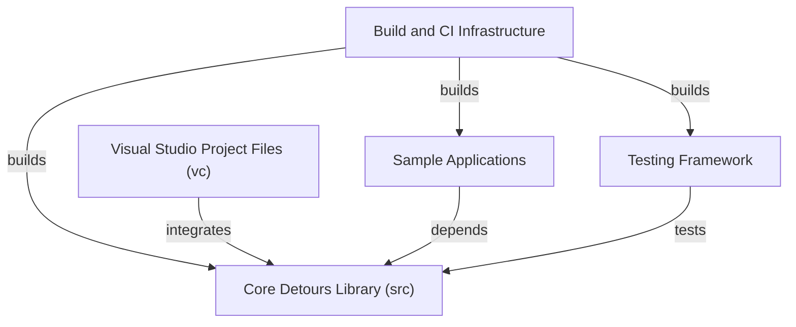

# microsoft/Detours

> Bibliothèque C++ de Microsoft pour intercepter et instrumenter les appels d'API sous Windows, destinée aux développeurs système.

## Le problème
Observer ou modifier le comportement d'un programme Windows sans toucher à son code source oblige à bricoler des correctifs binaires fragiles.

## Ce que ça fait vraiment
Detours fournit un noyau d'interception d'appels d'API (dossier `src`, avec `detours.cpp`, `detours.h` et des modules de désassemblage). Le dépôt contient la version 4.0.1, des exemples (`samples`) et des tests (`tests`). Il fonctionne sur la famille Windows NT jusqu'à Windows 11, mais pas pour les applications du Windows Store.

## Comment c'est branché


## Essayer
```bash
# Aucune commande documentée dans le README.
# Il renvoie au fichier README.txt du dossier samples pour compiler et lancer les exemples.
```

## Coût et pièges
Gratuit, licence MIT. Il faut compiler soi-même (fichiers Visual Studio ou Makefiles). Windows uniquement.

## Ce que ce n'est pas
Ce n'est pas un outil prêt à l'emploi : c'est une bibliothèque à intégrer dans son propre code C++. Elle ne sert pas aux applications du Windows Store et ne couvre ni Linux ni macOS.

## Alternatives
Aucune alternative n'est citée dans le README.

## Pour toi
À ignorer : c'est de l'instrumentation bas niveau sous Windows, loin des pipelines data, IA et MLOps, sauf besoin très précis de hooking.

