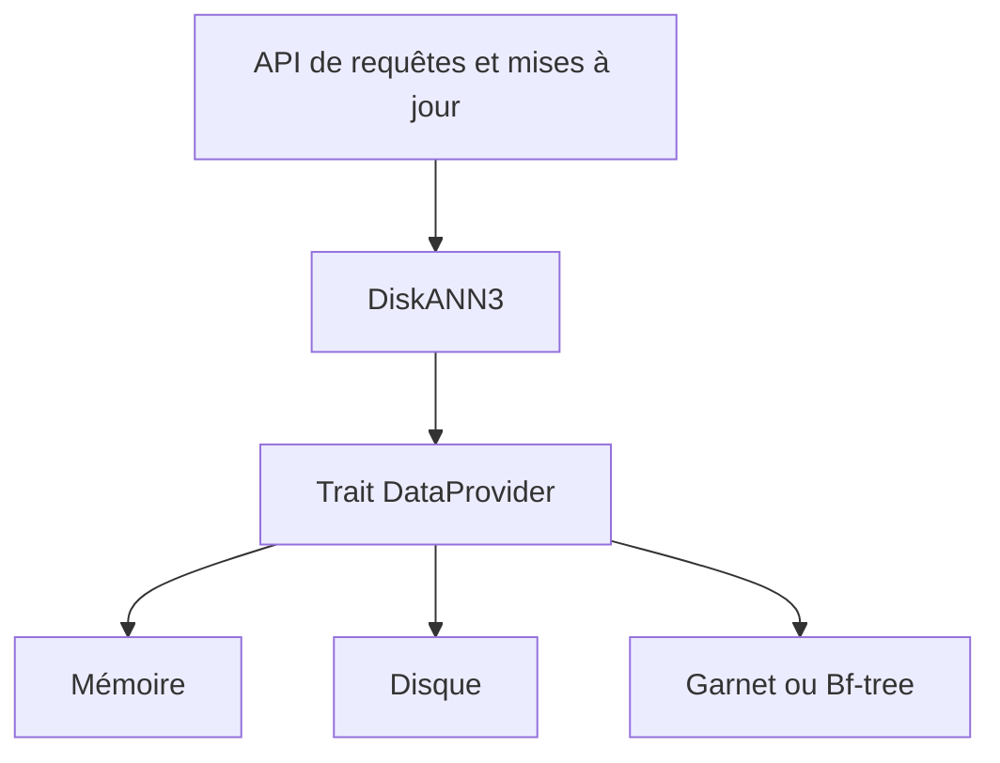

# microsoft/DiskANN

> Composable Rust vector-indexing library (DiskANN3), for people building a database.

## The problem
Plugging accurate approximate nearest-neighbor search into an existing database's storage, with continuous updates, without rebuilding the index.

## What it actually does
You implement the `DataProvider` trait for your storage; DiskANN3 provides the update and query APIs. The repo ships examples: in-memory, on-disk, Garnet and Bf-tree providers. Real-time updates, quantization (PQ, MinMax, scalar, spherical), pagination, distance filters, diversified top-k and attribute-filter hooks.

## How it is wired
Simplified diagram based on the sheet, no diagram provided.

## Trying it
No command is documented: the README points to `diskann-benchmarks` to build, store and load indexes.

## Cost and gotchas
Free; you must compile it and integrate a data provider. The Cosmos DB provider is not included. The legacy C++ code stays on the `cpp_main` branch, unmaintained. 212 open issues.

## What it is not
Not a ready-to-use vector database: it is a building block to integrate. The throughput comparisons with HNSWlib come from the README, with no figures provided.

## Alternatives
- HNSWlib: compared against the in-memory provider.

## For you
Worth watching: a serious reference for understanding vector indexing, but too low-level for direct use without a database engine to build.
