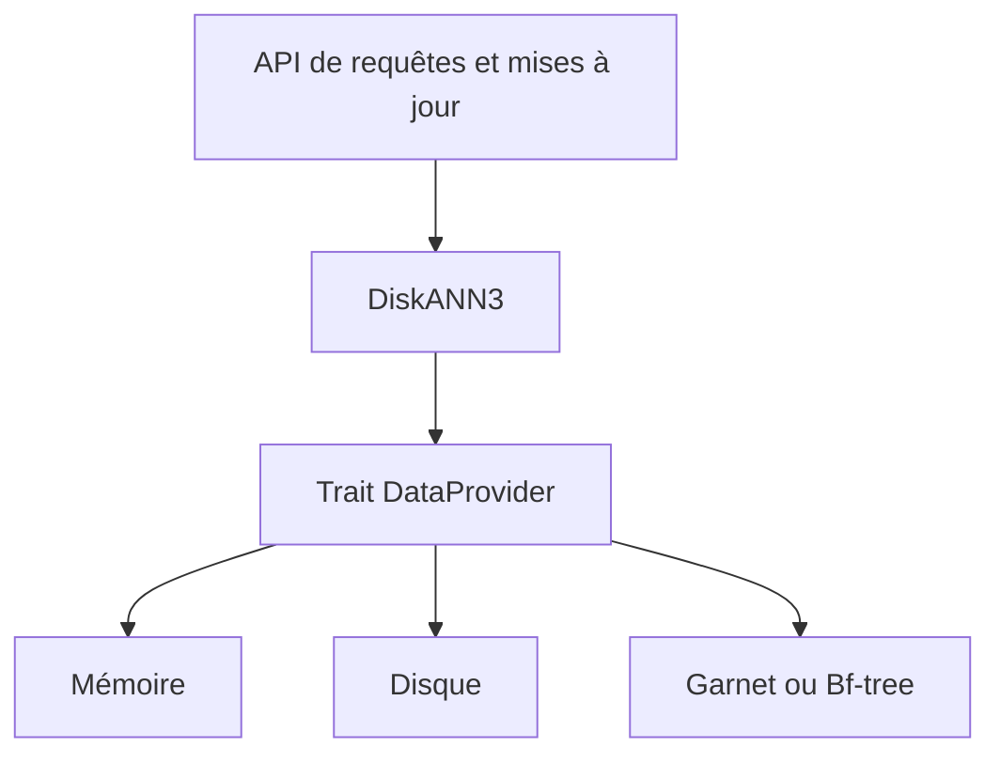

# microsoft/DiskANN

> Bibliothèque Rust composable d'indexation vectorielle (DiskANN3), pour ceux qui bâtissent une base de données.

## Le problème
Brancher une recherche de voisins approchés précise sur le stockage d'une base existante, avec mises à jour en continu, sans reconstruire l'index.

## Ce que ça fait vraiment
Tu implémentes le trait `DataProvider` pour ton stockage ; DiskANN3 fournit les API de mise à jour et de requête. Le dépôt livre des exemples : fournisseurs en mémoire, sur disque, Garnet et Bf-tree. Mises à jour en temps réel, quantification (PQ, MinMax, scalaire, sphérique), pagination, filtres par distance, top-k diversifié et crochets de filtres par attributs.

## Comment c'est branché
Schéma simplifié d'après la fiche, sans diagramme fourni.

## Essayer
Aucune commande n'est documentée : le README renvoie à `diskann-benchmarks` pour construire, stocker et charger des index.

## Coût et pièges
Gratuit ; il faut compiler et intégrer un fournisseur de données. Le fournisseur Cosmos DB n'est pas inclus. Le code C++ historique reste sur la branche `cpp_main`, non maintenu. 212 issues ouvertes.

## Ce que ce n'est pas
Pas une base vectorielle prête à l'emploi : c'est une brique à intégrer. Les comparaisons de débit avec HNSWlib viennent du README, sans chiffres fournis.

## Alternatives
- HNSWlib : comparée au fournisseur en mémoire.

## Pour toi
À surveiller : référence sérieuse pour comprendre l'indexation vectorielle, mais trop bas niveau pour un usage direct sans moteur de base à construire.

