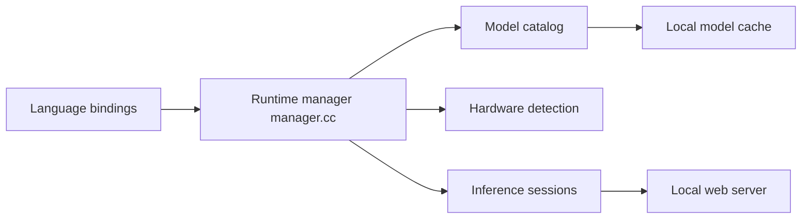

# microsoft/Foundry-Local

> Runtime and SDK to embed local AI models in an app, on CPU, GPU or NPU.

## The problem
Shipping an app with AI that runs on the user's device, with no backend, no API key and no per-token bill.

## What it actually does
C++ runtime (stable C ABI, ONNX Runtime) with C, C++, C#, JS, Python and Rust SDKs. It picks the model variant according to the hardware, downloads and caches models from a catalog (Qwen, Phi, Mistral, Whisper…). Chat, audio transcription, OpenAI-compatible API, optional web server and CLI in preview.

## How it is wired


## Trying it
```bash
pip install foundry-local-sdk
npm install foundry-local-sdk
foundry run qwen2.5-0.5b
foundry model list
```

## Cost and gotchas
Free, no key. Model downloads are heavy. The README states that usage data may be collected and sent to Microsoft. License not identified by GitHub.

## What it is not
Not a multi-user inference server: for that it points to vLLM or Triton. Inference cancellation is cooperative, with no native timeout.

## Alternatives
vLLM and Triton Inference Server for serving multiple users.

## For you
Keep an eye on it: relevant for shipping offline embedded AI, not for serving; check the license and telemetry before adopting it.
