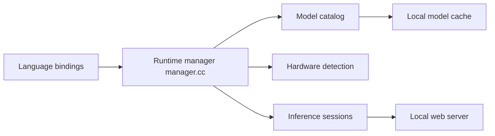

# microsoft/Foundry-Local

> Runtime et SDK pour embarquer des modèles d'IA locaux dans une appli, sur CPU, GPU ou NPU.

## Le problème
Livrer une appli avec de l'IA qui tourne sur l'appareil de l'utilisateur, sans backend, sans clé d'API ni facture au token.

## Ce que ça fait vraiment
Runtime C++ (ABI C stable, ONNX Runtime) avec SDK C, C++, C#, JS, Python et Rust. Il choisit la variante de modèle selon le matériel, télécharge et met en cache les modèles d'un catalogue (Qwen, Phi, Mistral, Whisper…). Chat, transcription audio, API compatible OpenAI, serveur web optionnel et CLI en préversion.

## Comment c'est branché


## Essayer
```bash
pip install foundry-local-sdk
npm install foundry-local-sdk
foundry run qwen2.5-0.5b
foundry model list
```

## Coût et pièges
Gratuit, pas de clé. Le téléchargement des modèles pèse. Le README indique une collecte possible de données d'usage envoyée à Microsoft. Licence non identifiée par GitHub.

## Ce que ce n'est pas
Pas un serveur d'inférence multi-utilisateurs : pour cela il renvoie vers vLLM ou Triton. L'annulation d'inférence est coopérative, sans timeout natif.

## Alternatives
vLLM et Triton Inference Server pour servir plusieurs utilisateurs.

## Pour toi
Surveiller : pertinent pour livrer de l'IA embarquée hors ligne, pas pour du serving ; vérifie la licence et la télémétrie avant de l'adopter.

