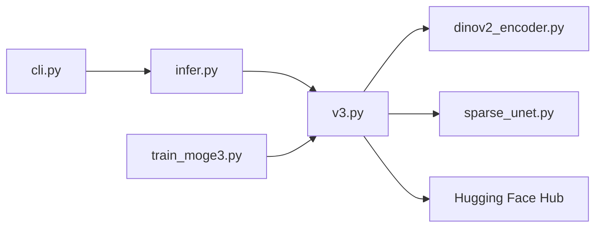

# microsoft/MoGe

> Model that estimates 3D geometry (depth, normals, point cloud, FOV) from a single image.

## The problem
Reconstructing a metric 3D scene from a single photo normally requires several views or dedicated hardware.

## What it actually does
From one image, a single forward pass returns a point map, depth, normals, a mask and camera intrinsics. Three generations (v1, v2, v3) with weights on Hugging Face, from 35M to 1.25B parameters. A `moge infer` CLI exports maps, `.glb` and `.ply`; a Gradio demo and an experimental panorama mode exist. Advertised latency: 60 ms per image (A100/RTX3090, FP16, ViT-L).

## How it is wired


## Trying it
```bash
git clone https://github.com/microsoft/MoGe.git
cd MoGe
uv sync
moge infer -i IMAGES_FOLDER_OR_IMAGE_PATH --version v2 --o OUTPUT_FOLDER --maps --glb --ply
moge app --version v2
```

## Cost and gotchas
CUDA GPU (CUDA 13.0 wheels by default). macOS is not supported for MoGe-3 (Triton). v3 requires a checkpoint passed via `--pretrained`.

## What it is not
Not a multi-view reconstruction tool. The license is not identified by GitHub: read it before any commercial use.

## Alternatives
No alternative named in the README.

## For you
Worth watching: useful if you do 3D vision or robotics, but check the license file first before embedding it.
