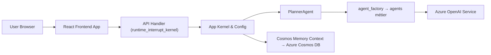

# microsoft/Multi-Agent-Custom-Automation-Engine-Solution-Accelerator

> Azure accelerator that orchestrates several specialized AI agents to automate business tasks; for Azure teams.

## The problem
Coordinating tasks across departments (HR, procurement, marketing, support) ties up teams and produces manual coordination errors.

## What it actually does
A React interface sends a task to a Python backend (Semantic Kernel). A planner agent breaks it down, domain agents (HR, Marketing, Procurement, Product, TechSupport, Human) carry it out through tools, and memory is persisted in Cosmos DB. The Azure deployment is described in Bicep, with Container Apps and Azure OpenAI.

## How it is wired


## Trying it
No deployment command in the README, which points to the deployment guide (azd 1.18.0+, Bicep 0.33.0+ locally). The only documented command, to tear everything down:
```bash
azd down
```

## Cost and gotchas
Azure subscription required, with Azure OpenAI quota; pay-as-you-go costs, except Container Registry which is billed per registry and per day. Remember to delete the resource group after trying it.

## What it is not
Not a finished product: the README calls it a proof of concept, with unreliable output, English only, and no warranty from Microsoft. Not a cloud-agnostic framework.

## Alternatives
No alternative cited; the README only points to other Microsoft accelerators (Document Knowledge Mining, Conversation Knowledge Mining).

## For you
Worth watching as a planner / executor architecture model on Azure, not to be deployed as is: a proof of concept tied to Azure and billed by usage.
