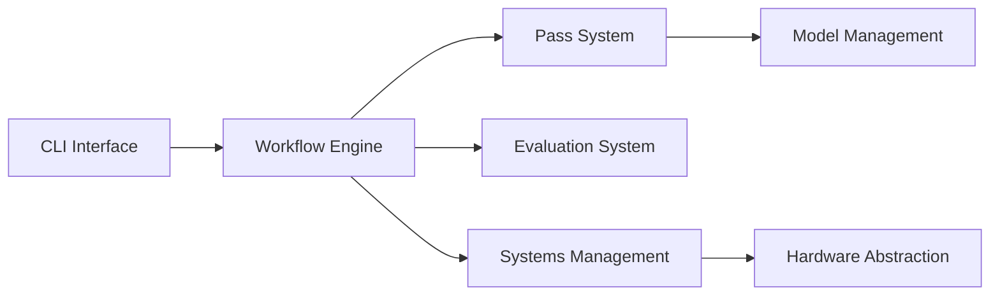

# microsoft/Olive

> A toolkit that optimizes a model for ONNX Runtime according to the target hardware and constraints.

## The problem
Optimizing a model (quantization, ONNX graph) for given hardware forces you to chain several tools by hand and measure accuracy and latency.

## What it actually does
Olive composes optimization techniques ("passes") and produces an ONNX model for cloud or edge. The `olive optimize` command fetches the Hugging Face model, quantizes it to int4 with GPTQ, captures the ONNX graph then optimizes it. A workflow engine, a cache and an evaluator drive the whole. Integrations exist with Hugging Face, Azure AI and MLflow.

## How it is wired


## Trying it
```bash
pip install olive-ai
pip install transformers onnxruntime-genai
olive optimize \
    --model_name_or_path Qwen/Qwen2.5-0.5B-Instruct \
    --precision int4 \
    --output_path models/qwen
```

## Cost and gotchas
Free. Downloads the model from Hugging Face; on Windows, a warning about cache symlinks (`HF_HUB_DISABLE_SYMLINKS_WARNING`). The README states that the distributions may send usage data to Microsoft.

## What it is not
It is not an inference engine: it produces models for ONNX Runtime, which runs them. Architectures outside the list require you to provide `io_config`.

## Alternatives
- No alternative named in the README.

## For you
Adopt if you deploy models via ONNX Runtime: one command chains quantization and optimization, but keep the possible telemetry in mind.
