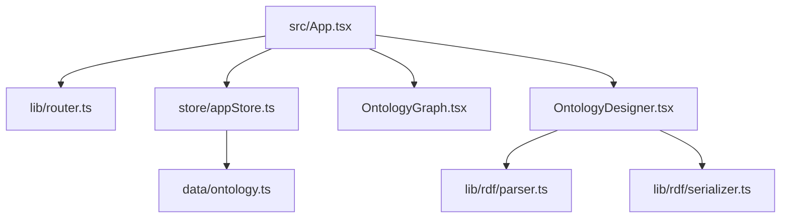

# microsoft/Ontology-Playground

> Static web application for learning ontologies, exploring a catalog and drawing your own for Microsoft Fabric IQ.

## The problem
Understanding and modeling an ontology (entities, relations, RDF) without a specialized editor is abstract and discouraging.

## What it actually does
Interactive Cytoscape.js graph, a catalog of official and community ontologies across six domains, a visual designer with undo and validation, and RDF/XML import and export that preserves the original bytes. A school of 9 courses, 5 quests, a natural-language query sandbox, an embeddable widget and PR submission to the catalog are included. The AI generator is disabled by default.

## How it is wired


## Trying it
```bash
cd Ontology-Playground
npm install
npm run dev
npm run build
npm test
npm run validate
```

## Cost and gotchas
Free, hosted on GitHub Pages. Node 18 and npm 9 for local use. The optional AI builder requires an Azure Functions backend and Azure OpenAI at your expense, behind an authenticated gateway. Preview status, project written with the help of an AI.

## What it is not
Not a triplestore or a SPARQL engine: it is a viewer and an editor. Turtle is not supported; SHACL is never executed.

## Alternatives
No alternative cited in the README.

## For you
Watch: useful for learning to model an ontology or a knowledge graph, but still in preview and tied to Fabric IQ.
