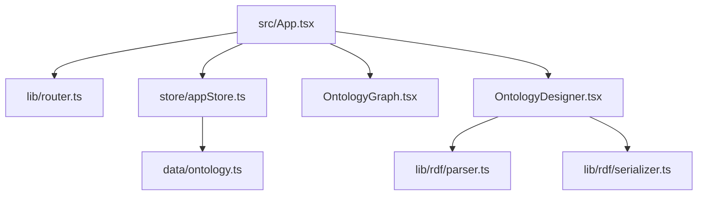

# microsoft/Ontology-Playground

> Application web statique pour apprendre les ontologies, explorer un catalogue et dessiner les siennes pour Microsoft Fabric IQ.

## Le problème
Comprendre et modéliser une ontologie (entités, relations, RDF) sans éditeur spécialisé est abstrait et décourageant.

## Ce que ça fait vraiment
Graphe interactif Cytoscape.js, catalogue d'ontologies officielles et communautaires sur six domaines, concepteur visuel avec annulation et validation, import et export RDF/XML en conservant les octets d'origine. Une école de 9 cours, 5 quêtes, un bac à sable de requêtes en langage naturel, un widget embarquable et une soumission de PR au catalogue sont inclus. Le générateur par IA est désactivé par défaut.

## Comment c'est branché


## Essayer
```bash
cd Ontology-Playground
npm install
npm run dev
npm run build
npm test
npm run validate
```

## Coût et pièges
Gratuit, hébergé sur GitHub Pages. Node 18 et npm 9 pour le local. Le constructeur IA, optionnel, exige un backend Azure Functions et Azure OpenAI à ta charge, derrière une passerelle authentifiée. Statut Preview, projet écrit avec l'aide d'une IA.

## Ce que ce n'est pas
Pas un triplestore ni un moteur SPARQL : c'est une visionneuse et un éditeur. Turtle n'est pas pris en charge ; SHACL n'est jamais exécuté.

## Alternatives
Aucune alternative citée dans le README.

## Pour toi
Surveiller : utile pour apprendre à modéliser une ontologie ou un graphe de connaissances, mais encore en preview et lié à Fabric IQ.

