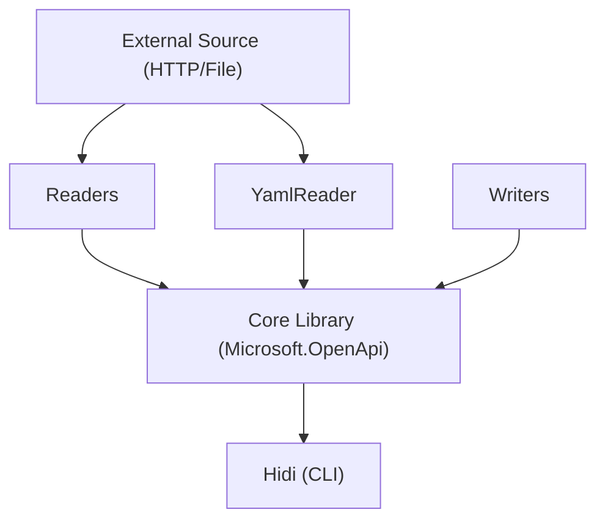

# microsoft/OpenAPI.NET

> .NET object model to read, build and write OpenAPI descriptions in JSON and YAML.

## The problem
Handling an OpenAPI document in .NET without a common model forces you to parse JSON or YAML by hand.

## What it actually does
Provides a shared object model, JSON and YAML readers (V2 and V3, now 3.2) and writers to both formats. External converters (C# annotations, OData CSDL) plug into it. Hidi, a command-line tool, validates and transforms descriptions.

## How it is wired


## Trying it
```csharp
var (openApiDocument, _) = await OpenApiDocument.LoadAsync("https://raw.githubusercontent.com/OAI/OpenAPI-Specification/refs/heads/main/_archive_/schemas/v3.0/pass/petstore.yaml");
var outputString = await openApiDocument.SerializeAsJsonAsync(OpenApiSpecVersion.OpenApi2_0);
```
Installation via NuGet: Microsoft.OpenApi and Microsoft.OpenApi.YamlReader.

## Cost and gotchas
Free. The new major version changes the API (see the upgrade guide). Requires .NET; Hidi for v3 lives in another repo.

## What it is not
Not a client code generator nor a server: only the model and serialization.

## Alternatives
No alternative named in the README.

## For you
Ignore: a .NET library, useful only if your service is in C#. In Python, other tools read OpenAPI.
