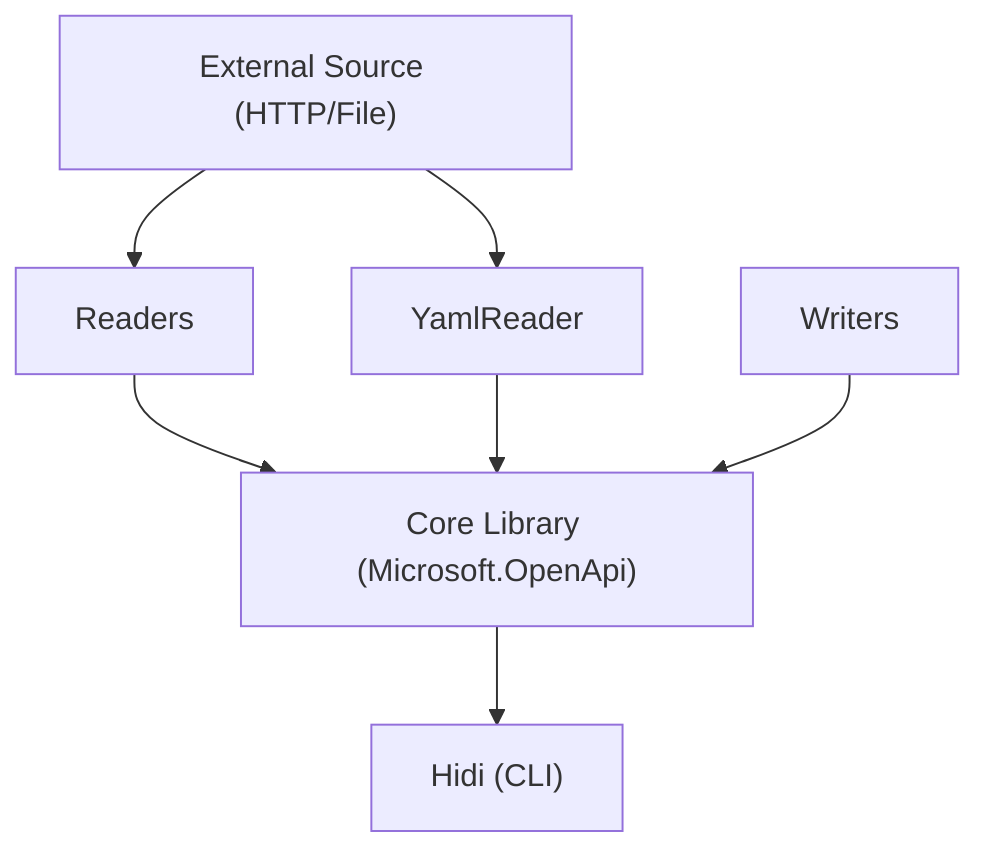

# microsoft/OpenAPI.NET

> Modèle objet .NET pour lire, construire et écrire des descriptions OpenAPI en JSON et YAML.

## Le problème
Manipuler un document OpenAPI sous .NET sans modèle commun oblige à parser du JSON ou du YAML à la main.

## Ce que ça fait vraiment
Fournit un modèle objet partagé, des lecteurs JSON et YAML (V2 et V3, désormais 3.2) et des écrivains vers les deux formats. Les convertisseurs externes (annotations C#, OData CSDL) s'y branchent. Hidi, un outil en ligne de commande, valide et transforme les descriptions.

## Comment c'est branché


## Essayer
```csharp
var (openApiDocument, _) = await OpenApiDocument.LoadAsync("https://raw.githubusercontent.com/OAI/OpenAPI-Specification/refs/heads/main/_archive_/schemas/v3.0/pass/petstore.yaml");
var outputString = await openApiDocument.SerializeAsJsonAsync(OpenApiSpecVersion.OpenApi2_0);
```
Installation par NuGet : Microsoft.OpenApi et Microsoft.OpenApi.YamlReader.

## Coût et pièges
Gratuit. La nouvelle version majeure change l'API (voir le guide de mise à jour). Il faut .NET ; Hidi pour la v3 vit dans un autre dépôt.

## Ce que ce n'est pas
Pas un générateur de code client ni un serveur : seulement le modèle et la sérialisation.

## Alternatives
Aucune alternative nommée dans le README.

## Pour toi
À ignorer : bibliothèque .NET, utile seulement si ton service est en C#. En Python, d'autres outils lisent OpenAPI.

