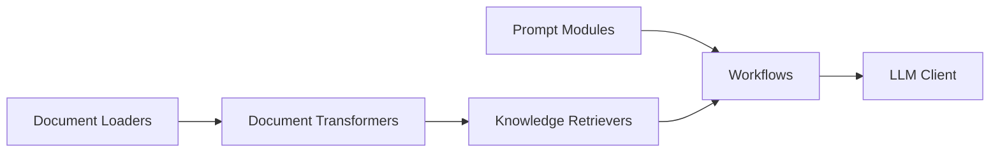

# microsoft/PIKE-RAG

> RAG framework based on domain knowledge extraction and reasoning, for complex multi-hop questions.

## The problem
Embedding search alone fails on professional corpora: chunking that breaks meaning, jargon and aliases poorly aligned, multi-step reasoning.

## What it actually does
Modules for document parsing, extraction, storage, retrieval (BM25, Chroma), organization and reasoning, driven by YAML workflows. The README claims 87.6% on HotpotQA, 82.0% on 2WikiMultiHopQA and 59.6% on MuSiQue. Azure and Hugging Face LLM clients. Archived repository.

## How it is wired

## Trying it
The README only gives steps: clone, create the Python environment, fill in a `.env` with the endpoints, edit the YAML configs and run the scripts in `examples/`. No exact command is provided.

## Cost and gotchas
LLM endpoints at your expense (mostly Azure). Archived, last push in September 2025: no more fixes expected. The scores are the author's own.

## What it is not
Not a maintained library nor a product: a research artifact to read or adapt.

## Alternatives
No alternative named in the README.

## For you
Ignore as a dependency: archived and without updates; worth reading for its ideas (dual rewriting, decomposition), not to install.
