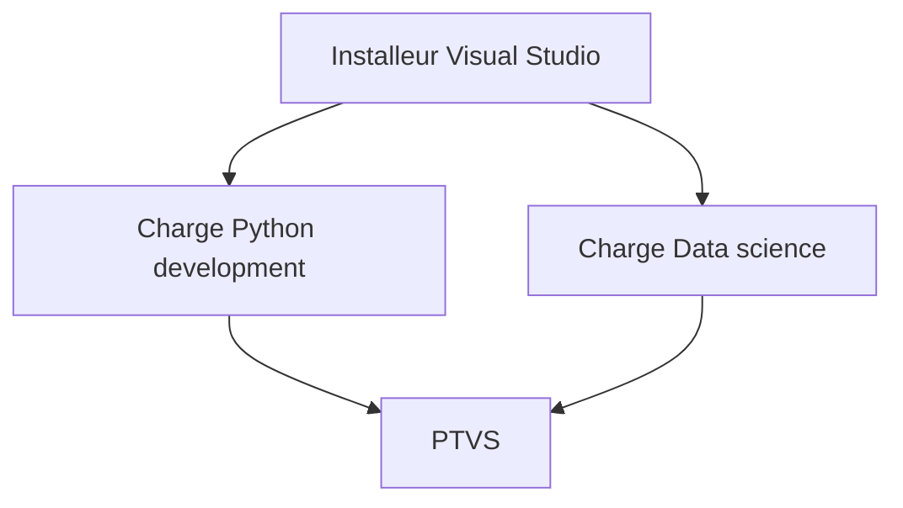

# microsoft/PTVS

> Python support for Visual Studio, developed here, for Python developers using Visual Studio on Windows.

## The problem
Doing Python in the Visual Studio IDE requires an extension that handles editing, running and debugging.

## What it actually does
The README is short: it points to the product page, the documentation, the issue tracker and the wiki. Installation goes through the "Python development" or "Data science and analytical applications" workload of the Visual Studio installer. The internal workings are not documented here.

## How it is wired
Simplified diagram based on the sheet, no diagram provided.

## Trying it
No command: choose the workload in the Visual Studio installer (2017 and 2019 according to the README).

## Cost and gotchas
Free with Visual Studio Community; Professional and Enterprise editions are paid. Versions for Visual Studio 2015 and earlier are no longer developed.

## What it is not
Not a VS Code extension. Not a tool independent of Visual Studio.

## Alternatives
No alternative named in the README.

## For you
Ignore: a data / AI profile mostly works in VS Code or JupyterLab, not in Visual Studio.
