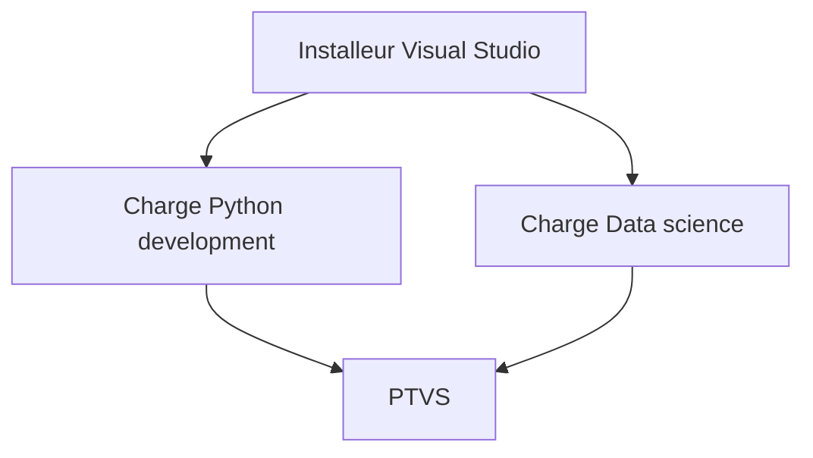

# microsoft/PTVS

> Support Python de Visual Studio, développé ici, pour développeurs Python sous Visual Studio sur Windows.

## Le problème
Faire du Python dans l'IDE Visual Studio demande une extension qui gère l'édition, l'exécution et le débogage.

## Ce que ça fait vraiment
Le README est court : il renvoie à la page produit, à la documentation, au suivi des tickets et au wiki. L'installation passe par la charge de travail « Python development » ou « Data science and analytical applications » du programme d'installation de Visual Studio. Le fonctionnement interne n'est pas documenté ici.

## Comment c'est branché
Schéma simplifié d'après la fiche, sans diagramme fourni.

## Essayer
Aucune commande : choisir la charge de travail dans l'installeur Visual Studio (2017 et 2019 d'après le README).

## Coût et pièges
Gratuit avec Visual Studio Community ; les éditions Professional et Enterprise sont payantes. Les versions pour Visual Studio 2015 et antérieures ne sont plus développées.

## Ce que ce n'est pas
Pas une extension pour VS Code. Pas un outil indépendant de Visual Studio.

## Alternatives
Aucune alternative nommée dans le README.

## Pour toi
Ignorer : un profil data / IA travaille surtout sous VS Code ou JupyterLab, pas sous Visual Studio.

