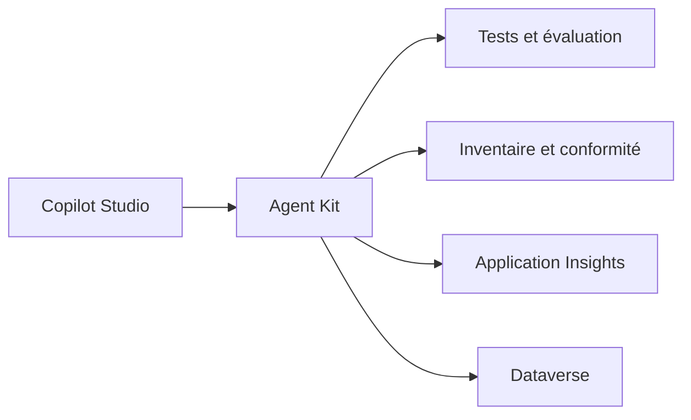

# microsoft/Power-CAT-Copilot-Studio-Kit

> Toolkit for testing, governing and analyzing Microsoft Copilot Studio agents.

## The problem
Copilot Studio agents deploy quickly, but batch testing, inventory, governance and cost tracking are missing.

## What it actually does
Managed Power Platform solutions: automated agent tests (response matching, multi-turn, topics), evaluation of a model change, inventory, compliance, conversation debugger, telemetry dashboards. A setup wizard guides the installation.

## How it is wired
Simplified diagram based on the sheet, no diagram provided.

## Trying it
No command documented: installation as a managed solution from Microsoft Marketplace or the Releases, then the setup wizard.

## Cost and gotchas
Power Platform licenses and AI Builder credits at your expense, depending on the kit's prerequisites. Test features limited to Entra ID v2 authentication with SSO. Several modules are in preview.

## What it is not
Not a standalone tool: it is only useful within the Microsoft Power Platform ecosystem. Not an agent framework.

## Alternatives
No alternative named in the README.

## For you
Worth watching: relevant only if your organization builds agents on Copilot Studio; otherwise useless.
