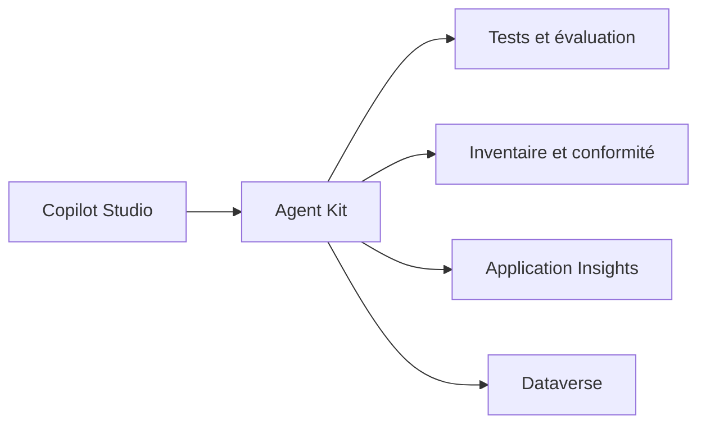

# microsoft/Power-CAT-Copilot-Studio-Kit

> Boîte à outils pour tester, gouverner et analyser des agents Microsoft Copilot Studio.

## Le problème
Les agents Copilot Studio se déploient vite, mais il manque tests par lots, inventaire, gouvernance et suivi de coûts.

## Ce que ça fait vraiment
Solutions gérées Power Platform : tests automatisés d'agents (correspondance de réponse, multi-tours, rubriques), évaluation d'un changement de modèle, inventaire, conformité, débogueur de conversation, tableaux de bord de télémétrie. Un assistant de configuration guide l'installation.

## Comment c'est branché
Schéma simplifié d'après la fiche, sans diagramme fourni.

## Essayer
Aucune commande documentée : installation par solution gérée depuis Microsoft Marketplace ou les Releases, puis assistant de configuration.

## Coût et pièges
Licences Power Platform et crédits AI Builder à ta charge, selon les prérequis du kit. Fonctions de test limitées à l'authentification Entra ID v2 avec SSO. Plusieurs modules sont en préversion.

## Ce que ce n'est pas
Pas un outil indépendant : il ne sert que dans l'écosystème Microsoft Power Platform. Pas un framework d'agents.

## Alternatives
Aucune alternative nommée dans le README.

## Pour toi
À surveiller : pertinent seulement si ton organisation construit des agents sur Copilot Studio ; sinon sans utilité.

