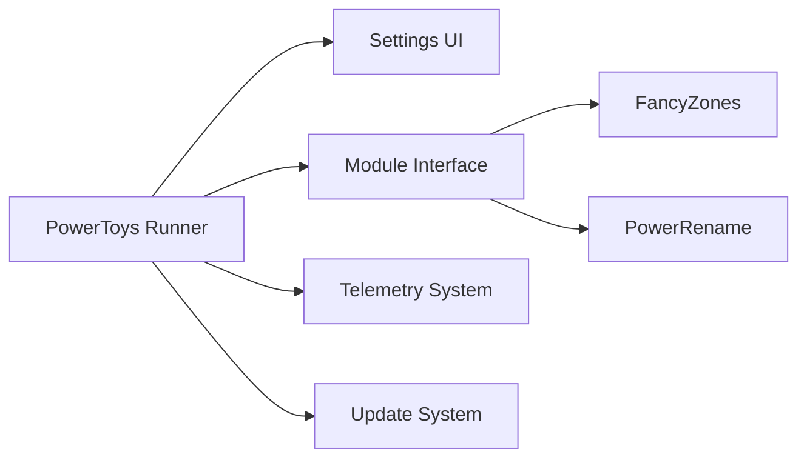

# microsoft/PowerToys

> A collection of over thirty utilities to customize and speed up Windows.

## The problem
Windows lacks some useful tools: window arrangement, bulk renaming, color selection, and keyboard remapping.

## What it actually does
A background executable (Runner) manages modules such as FancyZones, PowerRename, Keyboard Manager, Color Picker, Image Resizer, Awake, ZoomIt, and others. A settings interface configures each module. The architectural description of the block is a generic drawing plan, not a code reading: internal links are not documented.

## How it is wired


## Trying it
```bash
winget install Microsoft.PowerToys -s winget
winget install --scope machine Microsoft.PowerToys -s winget
```

## Cost and gotchas
Free. Available only for Windows. The application logs basic diagnostic information (telemetry), according to its privacy policy.

## What it is not
Not cross-platform and not related to data or AI. The provided architectural plan is generic.

## Alternatives
No alternative is specified in the README.

## For you
Ignore this unless you are working under Windows and prioritize comfort: it offers no benefits for data pipelines or MLOps.
