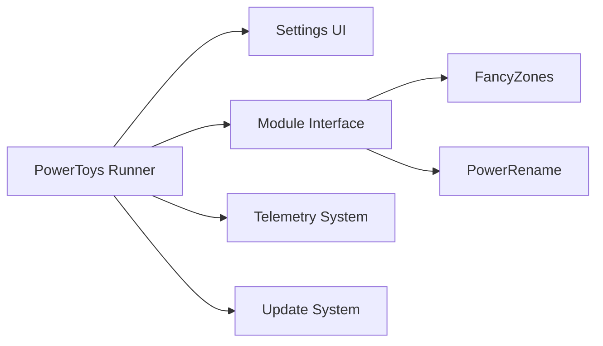

# microsoft/PowerToys

> Collection de plus de trente utilitaires pour personnaliser et accélérer Windows.

## Le problème
Windows manque de petits outils : disposition de fenêtres, renommage en masse, sélecteur de couleur, remappage de clavier.

## Ce que ça fait vraiment
Un exécutable de fond (Runner) charge des modules : FancyZones, PowerRename, Keyboard Manager, Color Picker, Image Resizer, Awake, ZoomIt et d'autres. Une interface de réglages configure chaque module. Le texte d'architecture du bloc est un plan de dessin générique, pas une lecture du code : les liens internes sont non documentés.

## Comment c'est branché


## Essayer
```bash
winget install Microsoft.PowerToys -s winget
winget install --scope machine Microsoft.PowerToys -s winget
```

## Coût et pièges
Gratuit. Windows uniquement. L'application journalise des diagnostics de base (télémétrie), selon sa documentation de confidentialité.

## Ce que ce n'est pas
Pas multiplateforme et sans rapport avec la donnée ou l'IA. Le plan d'architecture fourni est générique.

## Alternatives
Aucune alternative nommée dans le README.

## Pour toi
À ignorer sauf si tu travailles sous Windows et veux un confort de poste : aucun gain pour un pipeline data ou MLOps.

