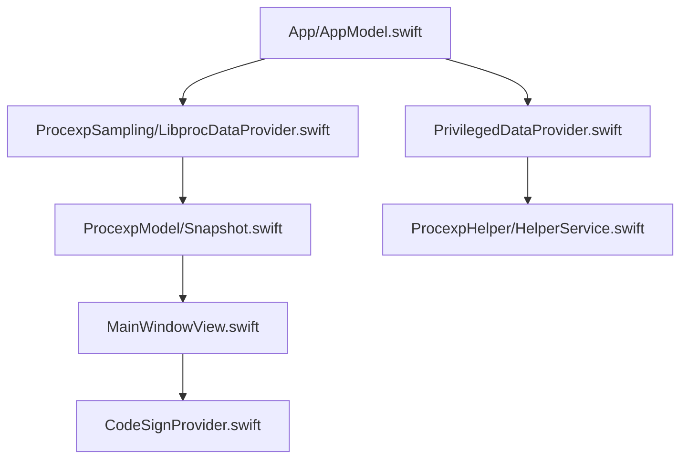

# microsoft/Procexp-Mac

> Native macOS version of Process Explorer: process tree, modules, handles and system graphs.

## The problem
macOS does not offer the fine-grained process inspection that Process Explorer users have on Windows.

## What it actually does
Samples processes via `libproc` and `sysctl`, shows a tree, property tabs, code signatures and CPU / memory / disk / network / GPU graphs. An optional root helper, reached over XPC, reveals other users' processes. VirusTotal integration for signatures.

## How it is wired


## Trying it
```bash
brew install xcodegen
xcodegen generate
xcodebuild -scheme ProcexpMac -configuration Debug build
swift test
```

## Cost and gotchas
macOS 14 or later, Xcode 26.6 recommended. No documented binary: you have to build it. The privileged helper requires a stable signature and approval in System Settings.

## What it is not
Not a complete copy of Process Explorer: some data is not exposed by public APIs, so the interface leaves empty fields.

## Alternatives
No alternative named in the README.

## For you
macOS system utility unrelated to data / AI; no license, so ignore.
