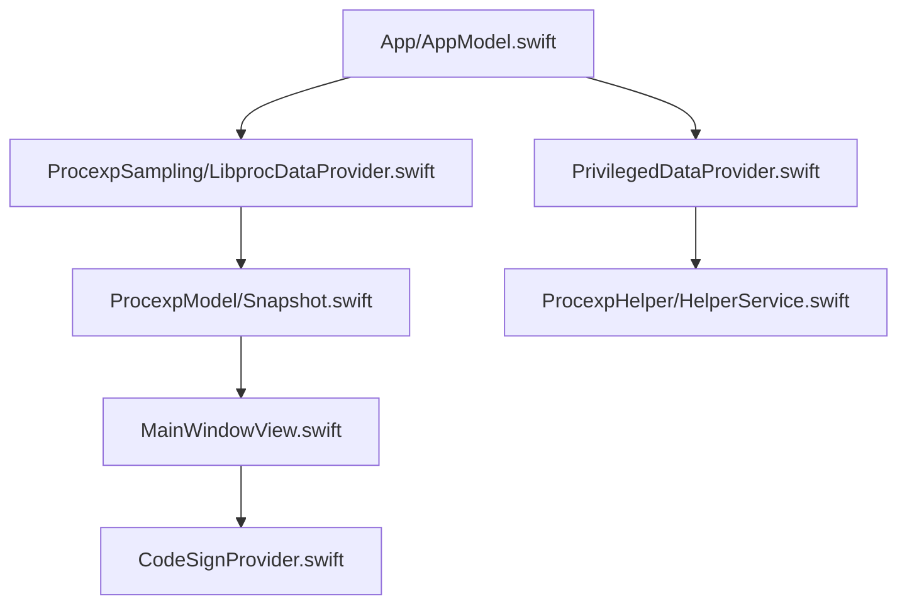

# microsoft/Procexp-Mac

> Version native macOS de Process Explorer : arbre de processus, modules, handles et graphes système.

## Le problème
macOS n'offre pas l'inspection fine de processus qu'ont les utilisateurs de Process Explorer sous Windows.

## Ce que ça fait vraiment
Échantillonne les processus via `libproc` et `sysctl`, affiche arbre, onglets de propriétés, signatures de code et graphes CPU / mémoire / disque / réseau / GPU. Un assistant root optionnel, joint par XPC, révèle les processus d'autres utilisateurs. Intégration VirusTotal pour les signatures.

## Comment c'est branché


## Essayer
```bash
brew install xcodegen
xcodegen generate
xcodebuild -scheme ProcexpMac -configuration Debug build
swift test
```

## Coût et pièges
macOS 14 ou plus, Xcode 26.6 recommandé. Pas de binaire documenté : il faut compiler. L'assistant privilégié exige une signature stable et une approbation dans Réglages Système.

## Ce que ce n'est pas
Pas une copie complète de Process Explorer : certaines données ne sont pas exposées par les API publiques, l'interface laisse alors des champs vides.

## Alternatives
Aucune alternative nommée dans le README.

## Pour toi
Utilitaire système macOS sans lien avec la data / IA ; licence absente, donc à ignorer.

