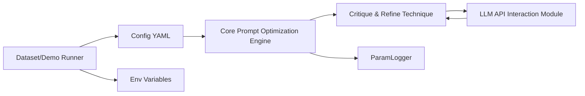

# microsoft/PromptWizard

> Prompt optimization framework where the LLM generates, critiques and refines its own instructions and examples.

## The problem
Hand-writing a good prompt, with its in-context examples, takes many trials with no reproducible method.

## What it actually does
From a task description and a base instruction, the tool has the LLM mutate the instruction, scores it on batches of questions, critiques it and refines it over several iterations. It also optimizes in-context examples (positive, negative, synthetic) and generates step-by-step reasoning. Three scenarios: without examples, with synthetic examples, with training data. Settings are in `promptopt_config.yaml`, keys in a `.env` file.

## How it is wired


## Trying it
```bash
git clone https://github.com/microsoft/PromptWizard
cd PromptWizard
python -m venv venv
source venv/bin/activate
pip install -e .
```
The scenarios are then run via the `demo.ipynb` notebook.

## Cost and gotchas
Each iteration calls the LLM: an OpenAI key or Azure OpenAI endpoint at your expense. The README claims 20 to 30 minutes of optimization on average on GSM8k, SVAMP, AQUARAT and BBII. The resulting prompts are very detailed: review and shorten them by hand.

## What it is not
It is not a turnkey generic library: each dataset needs its own processing class (`extract_final_answer`, `access_answer`) and answer format. The performance curves in the README are the authors' own.

## Alternatives
No alternative named in the README.

## For you
Keep an eye on it: useful for testing automatic prompt optimization on a task with a verifiable answer, but the code is research-grade (last push in October 2025) and its call cost is not quantified.
