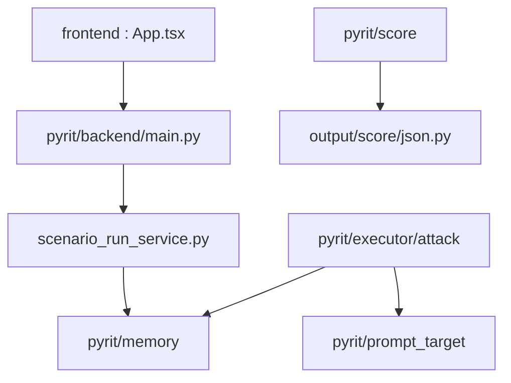

# microsoft/PyRIT

> Red teaming toolkit for testing the security and safety of generative AI models and applications.

## The problem
Generative AI systems have flaws (jailbreaks, harmful content) that are hard to test by hand and in a repeatable way.

## What it actually does
Three entry points: a command-line scanner, a CoPyRIT graphical interface and a Python framework. It runs automated evaluations, adaptive multi-turn attacks and human-led tests, on a very wide range of targets (OpenAI, Anthropic, Azure, Bedrock, Ollama, HTTP, WebSocket, Playwright). Conversation memory and scoring are built in.

## How it is wired


## Trying it
```bash
# Aucune commande dans le README : installation et configuration renvoyées au site du projet
```

## Cost and gotchas
Free (MIT), but the targets and the evaluator models consume your quotas or API keys. The available features depend on the target; the interface-to-API links remain unverified in the diagram provided.

## What it is not
Not a network intrusion scanner: it tests AI models. Not a guarantee of security, the results depend on the chosen scenarios.

## Alternatives
No alternative cited in the README (optional LiteLLM adapter for more providers).

## For you
Adopt: if you deploy models or agents, a reproducible red teaming test from a reputable vendor is good MLOps practice.
