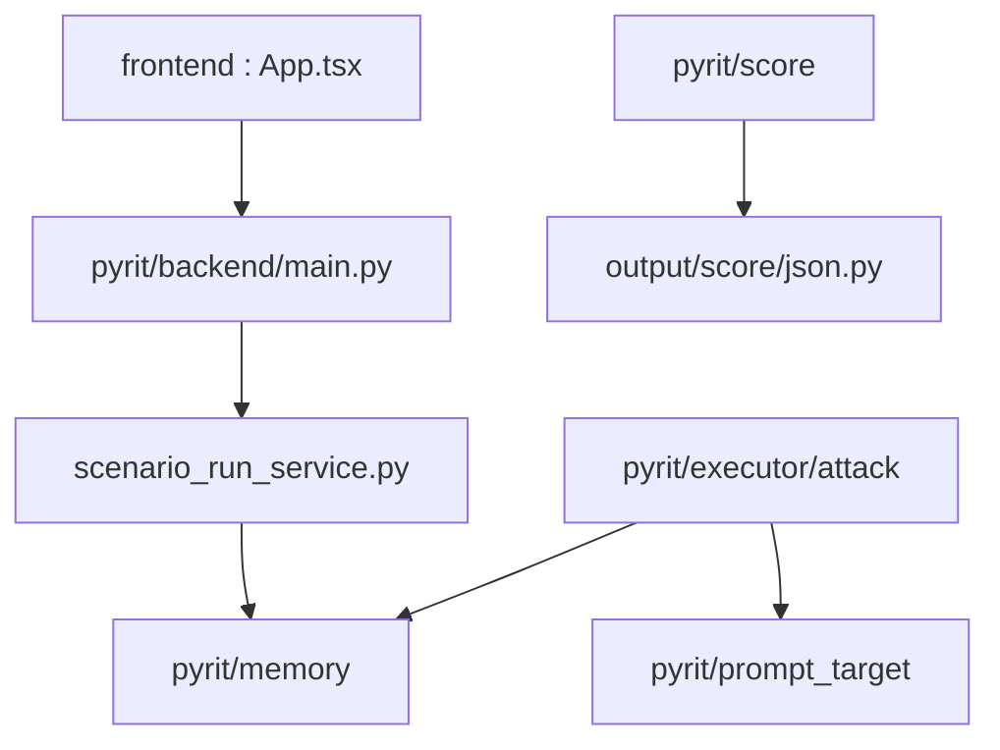

# microsoft/PyRIT

> Boîte à outils de red teaming pour tester la sécurité et la sûreté de modèles et d'applications d'IA générative.

## Le problème
Les systèmes d'IA générative ont des failles (contournements, contenus nuisibles) difficiles à tester à la main et de façon répétable.

## Ce que ça fait vraiment
Trois entrées : un scanner en ligne de commande, une interface graphique CoPyRIT et un cadre Python. Il lance des évaluations automatisées, des attaques adaptatives à plusieurs tours et des tests menés par un humain, sur des cibles très variées (OpenAI, Anthropic, Azure, Bedrock, Ollama, HTTP, WebSocket, Playwright). La mémoire des conversations et le scoring sont intégrés.

## Comment c'est branché


## Essayer
```bash
# Aucune commande dans le README : installation et configuration renvoyées au site du projet
```

## Coût et pièges
Gratuit (MIT), mais les cibles et les modèles évaluateurs consomment tes quotas ou clés d'API. Les fonctions disponibles dépendent de la cible ; les liens interface-API restent non vérifiés dans le schéma fourni.

## Ce que ce n'est pas
Pas un scanner d'intrusion réseau : il teste des modèles d'IA. Pas une garantie de sécurité, les résultats dépendent des scénarios choisis.

## Alternatives
Aucune alternative citée dans le README (adaptateur LiteLLM optionnel pour plus de fournisseurs).

## Pour toi
À adopter : si tu déploies des modèles ou des agents, un test de red teaming reproductible d'un éditeur reconnu est une bonne pratique MLOps.

