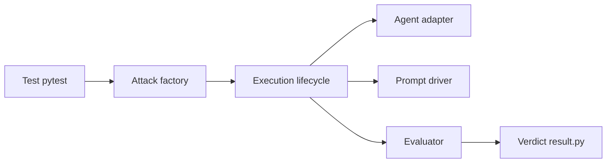

# microsoft/RAMPART

> A pytest framework for the security and safety of agentic AI applications.

## The problem
Testing attacks and failures of AI agents happens without a structured method or integration into regular tests.

## What it actually does
Minimal fiche: the README only describes a pytest framework covering adversarial attacks, benign failures, and harm categories, with evaluation-driven assertions. Based on the architecture: attack strategies (XPIA, single-turn), agent adapter, prompt drivers (static, LLM, PyRIT bridge), evaluators including an LLM judge, payload generator.

## How it is wired

## Trying it
No command documented in the README.

## Cost and gotchas
Not documented. The LLM judge probably implies model calls at your own cost (not confirmed by the README).

## What it is not
Not documented: installation, usage, and limitations are absent from the README.

## Alternatives
No alternative cited in the README (PyRIT only appears in the architecture).

## For you
To watch: a useful topic (agent red teaming, credible publisher) but impossible to evaluate without documentation.
