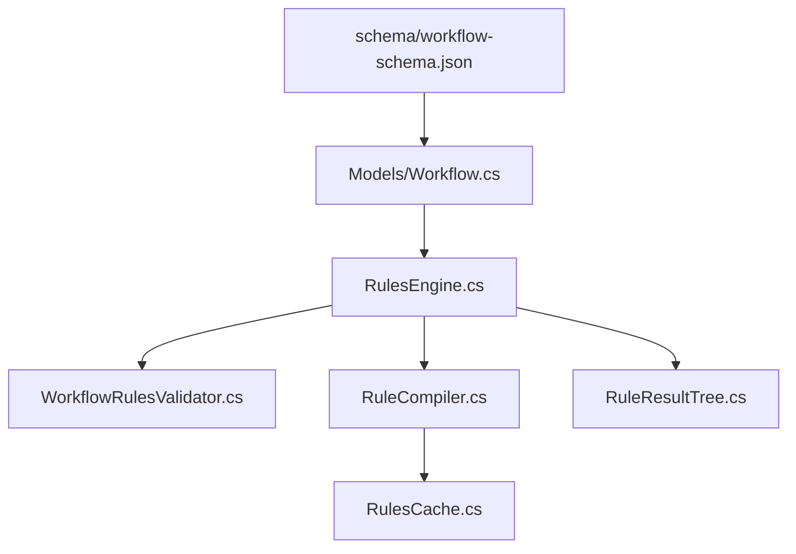

# microsoft/RulesEngine

> .NET library that takes business rules out of the code, stored as JSON, for C# developers.

## The problem
Hard-coded business rules force a recompile and redeploy at every policy change.

## What it actually does
Rules, grouped into `Workflow`s, are written in JSON with lambda expressions and can be stored anywhere (blob, Cosmos DB, EF, SQL, files). `RulesEngine` validates them, compiles them via `RuleCompiler` and an expression parser, caches them, then `ExecuteAllRulesAsync` returns a `RuleResultTree` showing which ones succeeded. Actions can run afterwards.

## How it is wired
Diagram based on the provided diagram.



## Trying it
```csharp
var rulesEngine = new RulesEngine(workflow);
List<RuleResultTree> response = await rulesEngine.ExecuteAllRulesAsync(workflowName, input);
```

## Cost and gotchas
Free. You must write the wrapper that loads the rules and handles the output yourself. For nested rules with Entity Framework, one `ThenInclude` per level is needed.

## What it is not
Not an inference engine nor machine learning: explicit conditions evaluated on objects. No editor provided (a third-party Blazor editor exists).

## Alternatives
No alternative named in the README.

## For you
Keep an eye on it: interesting if you need readable business guardrails around a model in a .NET service; otherwise irrelevant.
