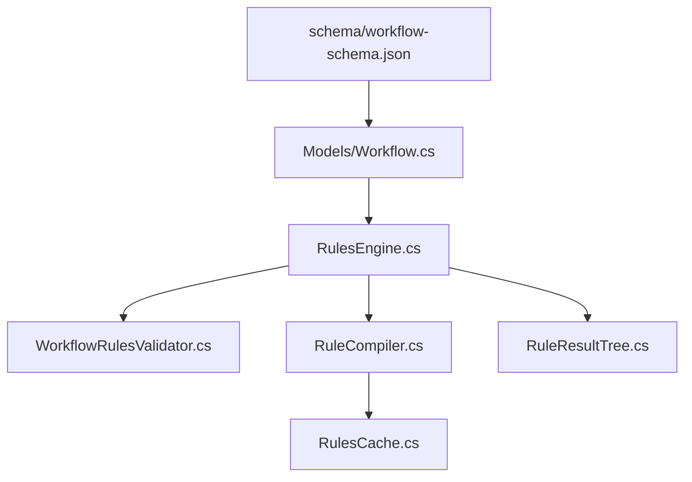

# microsoft/RulesEngine

> Bibliothèque .NET qui sort les règles métier du code, stockées en JSON, pour développeurs C#.

## Le problème
Les règles métier codées en dur obligent à recompiler et redéployer à chaque changement de politique.

## Ce que ça fait vraiment
Les règles, regroupées en `Workflow`, s'écrivent en JSON avec des expressions lambda et se stockent où l'on veut (blob, Cosmos DB, EF, SQL, fichiers). `RulesEngine` les valide, les compile via `RuleCompiler` et un parseur d'expressions, les met en cache, puis `ExecuteAllRulesAsync` renvoie un arbre `RuleResultTree` indiquant lesquelles ont réussi. Des actions peuvent s'exécuter ensuite.

## Comment c'est branché
Schéma d'après le diagramme fourni.



## Essayer
```csharp
var rulesEngine = new RulesEngine(workflow);
List<RuleResultTree> response = await rulesEngine.ExecuteAllRulesAsync(workflowName, input);
```

## Coût et pièges
Gratuit. Il faut écrire soi-même l'enveloppe qui charge les règles et traite la sortie. Pour des règles imbriquées avec Entity Framework, un `ThenInclude` par niveau est nécessaire.

## Ce que ce n'est pas
Pas un moteur d'inférence ni de machine learning : des conditions explicites évaluées sur des objets. Pas d'éditeur fourni (un éditeur Blazor tiers existe).

## Alternatives
Aucune alternative nommée dans le README.

## Pour toi
À surveiller : intéressant si tu dois mettre des garde-fous métier lisibles autour d'un modèle dans un service .NET ; sinon sans objet.

