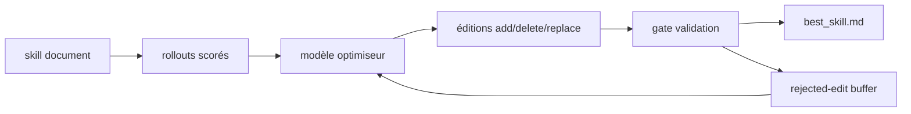

# microsoft/SkillOpt

> Trains a skill document the way you train weights, without touching the model.

## The problem
Agent skills are written by hand or generated in one shot, and uncontrolled self-revision does not reliably improve the starting point.

## What it actually does
Treats the skill document as the trainable state of a frozen agent. An optimizer model turns scored rollouts into bounded add/delete/replace edits; in the default path an edit is accepted only if it strictly improves a held-out validation score. Textual "learning rate" budget, rejected-edit buffer, slow/meta update per epoch. The deployed artifact is a `best_skill.md` of 300–2000 tokens, with no extra model call at inference.

## How it is wired


## Trying it
```bash
pip install -e ".[webui]"
python -m skillopt_webui.app
```

## Cost and gotchas
The README does not give the training command (deferred to `docs/`). Two models are used (target + optimizer) on repeated rollouts: the API bill is that of an optimization loop, not a single call. The Gradio WebUI listens on `0.0.0.0` by default — use `--host 127.0.0.1`.

## What it is not
Not fine-tuning: no weights are modified. The announced figures (+23.5 points on GPT-5.5 in direct chat, 52 cells) come from the authors and their paper, not from an independent reproduction. No license is declared in the README.

## Alternatives
- No alternative repository named in the README.

## For you
A sound idea — versioning and scoring a system prompt as an artifact. Worth watching, not to be plugged in until the license is clear.
