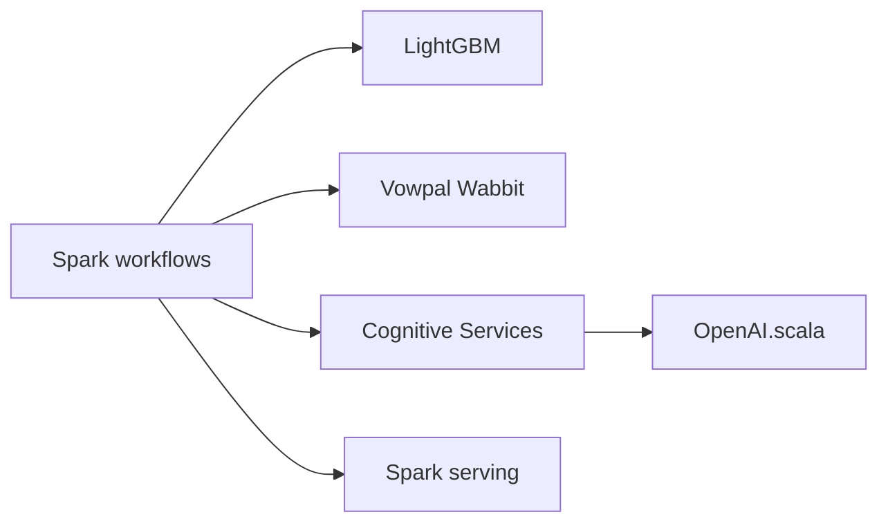

# microsoft/SynapseML

> Library of distributed ML pipelines on Apache Spark, for data and ML engineers.

## The problem
Training and serving models at scale requires integrating several engines into Spark.

## What it actually does
SparkML-compatible API: LightGBM and Vowpal Wabbit on Spark, cognitive services, ONNX, Isolation Forest, Spark Serving, Responsible AI, HTTP on Spark. Available in Python, R, Scala, Java, .NET. Installation has two parts: a Python package and JVM artifacts (Maven coordinates per Spark/Scala version).

## How it is wired


## Trying it
```bash
python -m pip install "synapseml==1.1.3" "pyspark>=3.5,<3.6"
pyspark --repositories "https://mmlspark.blob.core.windows.net/maven" \
  --packages "com.microsoft.azure:synapseml_2.12:1.1.3"
```

## Cost and gotchas
A Spark cluster is required. `pip install` alone does not add the JARs: otherwise a JVM class is not found. Calls to Azure services are billed.

## What it is not
Not a lightweight single-machine library.

## Alternatives
- LightGBM and Vowpal Wabbit: the original engines, outside Spark.

## For you
Worth watching: relevant if you already have Spark (Databricks, Fabric); otherwise too heavy.
