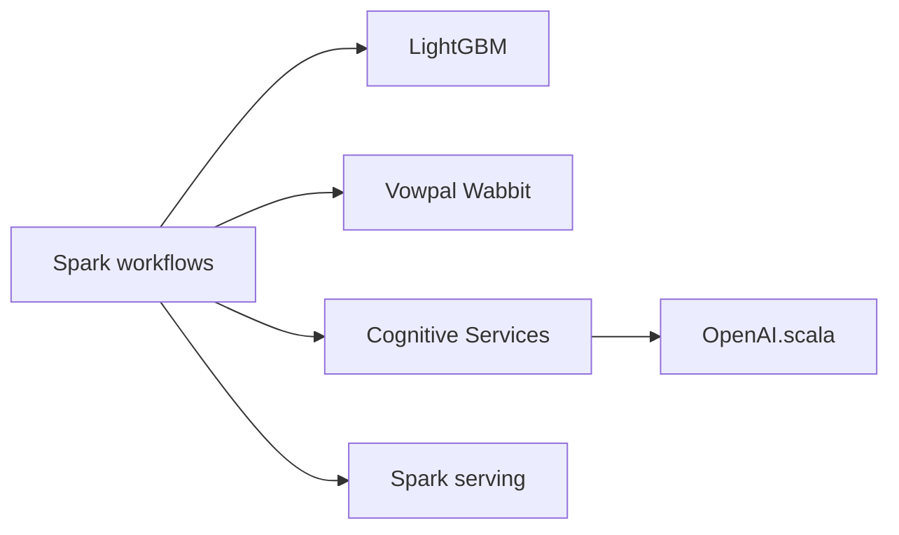

# microsoft/SynapseML

> Bibliothèque de pipelines ML distribués sur Apache Spark, pour ingénieurs data et ML.

## Le problème
Entraîner et servir des modèles à grande échelle demande d'intégrer plusieurs moteurs dans Spark.

## Ce que ça fait vraiment
API compatible SparkML : LightGBM et Vowpal Wabbit sur Spark, services cognitifs, ONNX, Isolation Forest, Spark Serving, Responsible AI, HTTP on Spark. Disponible en Python, R, Scala, Java, .NET. L'installation a deux volets : paquet Python et artefacts JVM (coordonnées Maven par version de Spark/Scala).

## Comment c'est branché


## Essayer
```bash
python -m pip install "synapseml==1.1.3" "pyspark>=3.5,<3.6"
pyspark --repositories "https://mmlspark.blob.core.windows.net/maven" \
  --packages "com.microsoft.azure:synapseml_2.12:1.1.3"
```

## Coût et pièges
Un cluster Spark est nécessaire. `pip install` seul n'ajoute pas les JAR : classe JVM introuvable sinon. Appels aux services Azure facturés.

## Ce que ce n'est pas
Pas une bibliothèque mono-machine légère.

## Alternatives
- LightGBM et Vowpal Wabbit : les moteurs d'origine, hors Spark.

## Pour toi
À surveiller : pertinent si tu as déjà Spark (Databricks, Fabric) ; sinon trop lourd.

