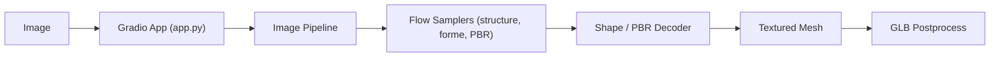

# microsoft/TRELLIS.2

> 4-billion-parameter model that generates textured 3D assets from an image.

## The problem
Producing 3D models with complex topologies and PBR materials from an image is slow and manual.

## What it actually does
Three-stage flow image-to-3D pipeline (structure, shape, PBR materials) on an "O-Voxel" representation. Outputs a textured mesh and a GLB. Announced times on H100: about 3 s at 512³, 17 s at 1024³, 60 s at 1536³. The repository also includes training and a web demo.

## How it is wired


## Trying it
```bash
git clone -b main https://github.com/microsoft/TRELLIS.2.git --recursive
cd TRELLIS.2
. ./setup.sh --new-env --basic --flash-attn --nvdiffrast --nvdiffrec --cumesh --o-voxel --flexgemm
python app.py
```

## Cost and gotchas
NVIDIA GPU with at least 24 GB (A100/H100 verified), Linux only, CUDA Toolkit compiled (12.4 recommended). Long installation.

## What it is not
Not a tool for non-specialists: heavy dependencies and tested only on Linux. The GLB comes out in opaque mode; transparency must be set by hand.

## Alternatives
No alternative named in the README.

## For you
Watch: a serious 3D model with training code, but it requires a 24 GB GPU and a demanding installation.
