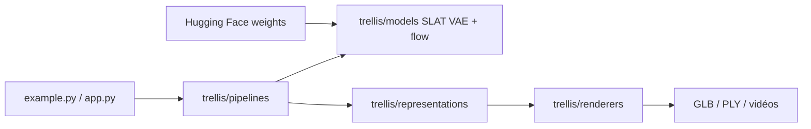

# microsoft/TRELLIS

> Model that generates 3D objects from text or an image, for researchers and creators.

## The problem
Producing textured 3D assets requires manual modeling or methods limited to a single output format.

## What it actually does
Structured latent representation (SLAT) decodable into 3D Gaussians, radiance fields or meshes, with rectified-flow transformers. Models of up to 2 billion parameters, trained on 500K objects, hosted on Hugging Face. Local editing and variants, GLB and PLY export, Gradio demo, training code.

## How it is wired


## Trying it
```bash
git clone --recurse-submodules https://github.com/microsoft/TRELLIS.git
cd TRELLIS
. ./setup.sh --new-env --basic --xformers --flash-attn --diffoctreerast --spconv --mipgaussian --kaolin --nvdiffrast
python app.py
```

## Cost and gotchas
NVIDIA GPU with at least 16 GB, tested on Linux (Windows not fully tested), CUDA 11.8 or 12.2. Long installation with submodule compilation. Last push on 2026-06-26.

## What it is not
Not a ready-to-use service; the README recommends the image-conditioned version over the text-conditioned one.

## Alternatives
No alternative cited in the README.

## For you
Watch: a serious reference for generative 3D under MIT, but reserved for those with a 16 GB GPU.
