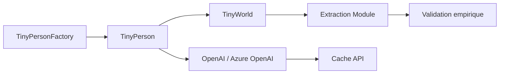

# microsoft/TinyTroupe

> Python library for simulating LLM personas for market research and testing.

## The problem
Testing an ad, a product or a chatbot against varied user profiles is expensive with real panels.

## What it actually does
`TinyPerson`: a persona defined in JSON or in code, which listens and acts; `TinyWorld`: an environment where several personas interact.
`TinyPersonFactory` generates populations from demographic data, in parallel.
Extraction of results and empirical validation against real surveys (t-test, KS-test).
Caching of LLM calls and of simulation state, cost tracking.

## How it is wired


## Trying it
```bash
conda create -n tinytroupe python=3.10
conda activate tinytroupe
pip install git+https://github.com/microsoft/TinyTroupe.git@main
```

## Cost and gotchas
API costs can be significant (gpt-5-mini by default); caching is recommended. An OpenAI or Azure OpenAI key is required.

## What it is not
Not an assistant, and not a decision tool: the legal disclaimer says "insight, not decision". The API changes often.

## Alternatives
- Autogen, Crew AI: for agents that solve tasks rather than simulate people.

## For you
Worth watching: synthetic data generation and statistical validation are interesting for a data scientist, but the project remains research, with an unstable API.
