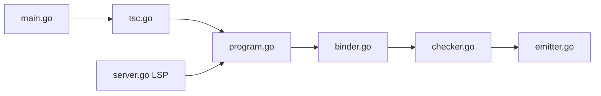

# microsoft/TypeScript

> A language that adds optional types to JavaScript and compiles it to standard JavaScript, for large-scale projects.

## The problem
Large JavaScript codebases become fragile without types and reliable editor tooling.

## What it actually does
Parses the sources, checks the types, reports errors and emits readable JavaScript plus declaration files. It also provides a language server for the editor (completion, navigation, refactoring), a watch mode and incremental builds. The code described by the architecture is in Go (program.go, checker.go, server.go), with a native API.

## How it is wired


## Trying it
```bash
npm install -D typescript
npm install -D typescript@next
```
The second command installs the nightly builds.

## Cost and gotchas
Free. The nightly version can break: keep it for testing.

## What it is not
Not a runtime: the code runs after being compiled to JavaScript. Types disappear at run time.

## Alternatives
No alternative named in the README.

## For you
Adopt for any JS/Node code (MCP tools, dashboards): types catch errors before execution, at the price of a compilation step.
