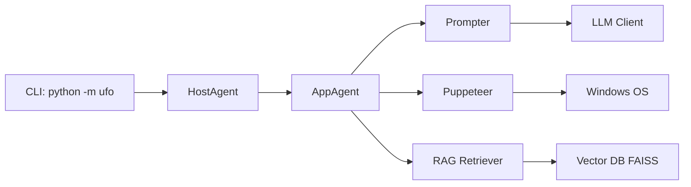

# microsoft/UFO

> Microsoft Research GUI agent that automates Windows (UFO²) and orchestrates multiple devices (Galaxy).

## The problem
Automating multi-application tasks on a Windows machine, or spread across Windows, Linux and Android, currently means fragile per-application scripts.

## What it actually does
UFO²: a HostAgent breaks down the request, per-application AppAgents follow a ReAct loop and act through UIA/Win32/COM or GUI clicks (Puppeteer), with RAG over docs and traces. UFO³ Galaxy: a ConstellationAgent turns the request into a DAG of tasks, assigned to device agents via the AIP protocol over WebSocket. UFO² is in long-term support, Galaxy in active development.

## How it is wired


## Trying it
```bash
pip install -r requirements.txt
copy config\ufo\agents.yaml.template config\ufo\agents.yaml
python -m ufo --task <task_name>
python -m galaxy --interactive
```

## Cost and gotchas
OpenAI or Azure OpenAI key (or another model) is on you, each task multiplies LLM calls. UFO² requires Windows; Galaxy requires configuring servers, clients and MCP per device.

## What it is not
Not a deterministic RPA tool: actions depend on the LLM. Galaxy is presented by its authors as suited to experimentation and non-critical workflows.

## Alternatives
- TaskWeaver: Microsoft "code-first" agent oriented toward data analytics, if the need is analysis rather than interface control.

## For you
Worth watching: a serious reference (company, papers, WAA/OSWorld benchmarks) for interface automation, but outside the data/MLOps core unless you need to drive Windows applications.
