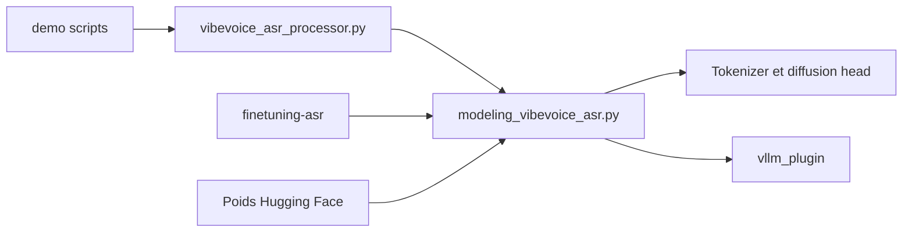

# microsoft/VibeVoice

> Microsoft's family of open voice models (speech recognition and synthesis), aimed at research.

## The problem
Conventional transcription models cut audio into short chunks and lose context and speaker identity over long recordings.

## What it actually does
VibeVoice-ASR processes up to 60 minutes in a single pass and returns who speaks, when and what, with custom keywords; a streaming variant transcribes while the sound arrives, and a BitNet variant targets CPU. The repository also contains VibeVoice-Realtime-0.5B (real-time TTS). The code for long-form VibeVoice-TTS was removed after misuse. The model relies on continuous tokenizers at 7.5 Hz, an LLM and a diffusion head; a vLLM server and LoRA fine-tuning are provided.

## How it is wired

## Trying it
No command documented in this README: see the documentation, Playground and Colab links.

## Cost and gotchas
Weights must be downloaded from Hugging Face; GPU hardware requirements are not quantified here for the 7B model. The README advises against commercial use without additional testing and flags a deepfake risk.

## What it is not
It is not a production-ready offering, and long-form synthesis (VibeVoice-TTS) is disabled in this repository.

## Alternatives
No alternative named in the README.

## For you
Watch: transcribing long meetings is a real need, but the project remains research-grade, with no recommended commercial use.
