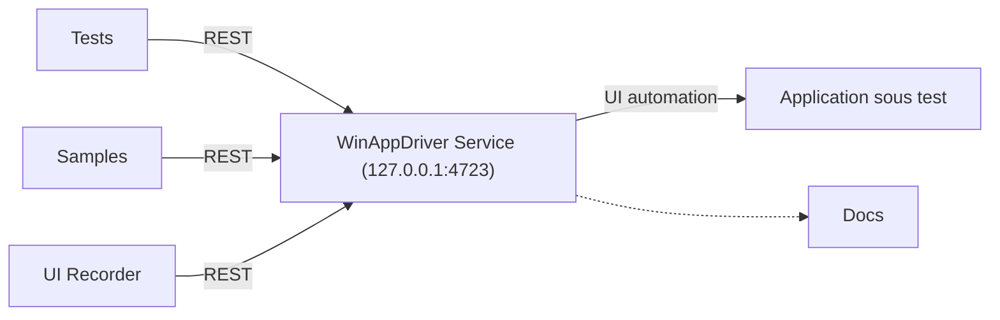

# microsoft/WinAppDriver

> Selenium-style UI test automation service for Windows applications (UWP, WinForms, WPF, Win32).

## The problem
Automatically testing the interface of a Windows desktop application requires a driver compatible with Selenium-type tools.

## What it actually does
A `WinAppDriver.exe` service listens over REST (127.0.0.1:4723 by default) and runs UI automation commands on the application under test. The repository also contains samples, tests, documentation and a UI Recorder that generates C#.

## How it is wired


## Trying it
```bash
WinAppDriver.exe 4727
WinAppDriver.exe 10.0.0.10 4725
```
Download the installer, then Windows developer mode must be enabled and `WinAppDriver.exe` launched.

## Cost and gotchas
Free. Windows 10 only, with developer mode. Changing the address or port requires administrator rights. 1,155 open issues.

## What it is not
It is not cross-platform, nor tested on other versions of Windows. The last push dates from April 2025: the project is no longer actively maintained.

## Alternatives
No alternative named in the README.

## For you
Ignore: Windows UI testing unrelated to data or AI, and a repository with little activity.
