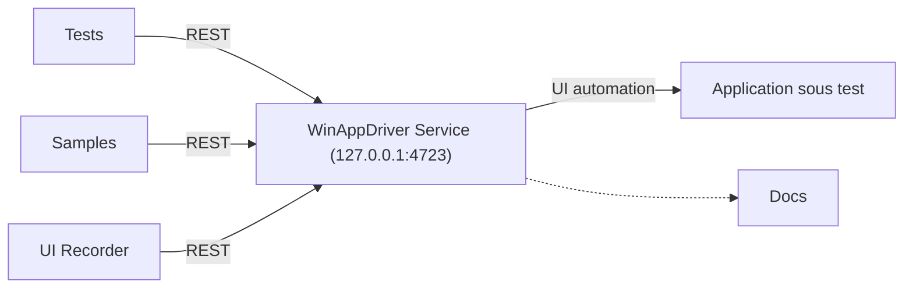

# microsoft/WinAppDriver

> Service d'automatisation de tests d'interface type Selenium pour applications Windows (UWP, WinForms, WPF, Win32).

## Le problème
Tester automatiquement l'interface d'une application de bureau Windows demande un pilote compatible avec les outils type Selenium.

## Ce que ça fait vraiment
Un service `WinAppDriver.exe` écoute en REST (127.0.0.1:4723 par défaut) et exécute les commandes d'automatisation de l'interface sur l'application testée. Le dépôt contient aussi des exemples, des tests, une documentation et un enregistreur d'interface (UI Recorder) qui génère du C#.

## Comment c'est branché


## Essayer
```bash
WinAppDriver.exe 4727
WinAppDriver.exe 10.0.0.10 4725
```
L'installeur se télécharge, puis le mode développeur Windows doit être activé et `WinAppDriver.exe` lancé.

## Coût et pièges
Gratuit. Windows 10 uniquement, avec le mode développeur. Changer l'adresse ou le port demande les droits administrateur. 1 155 issues ouvertes.

## Ce que ce n'est pas
Ce n'est pas un outil multiplateforme ni testé sur d'autres versions de Windows. Le dernier push date d'avril 2025 : le projet n'est plus suivi activement.

## Alternatives
Aucune alternative nommée dans le README.

## Pour toi
À ignorer : test d'interface Windows sans rapport avec la data ou l'IA, et dépôt peu actif.

