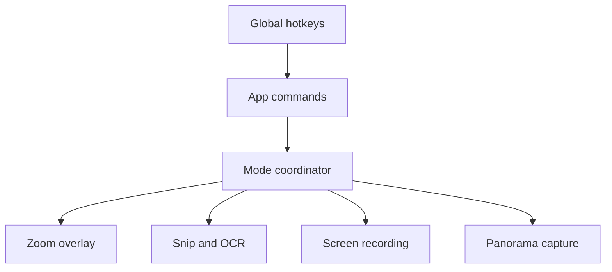

# microsoft/ZoomitForMac

> macOS menu bar utility to zoom, annotate, capture and record the screen, for presenters.

## The problem
Presenting or documenting on screen on a Mac requires zoom, annotations, captures and recording in a single tool.

## What it actually does
Static or live zoom, drawing and text, screenshots and snips, local OCR (Apple Vision), break timer, MP4 recording with an editor, webcam and scrolling panorama. From the code, a mode coordinator receives commands from global hotkeys and routes them to each feature.

## How it is wired


## Trying it
```sh
brew install --cask microsoft/sysinternalstap/zoomit
swift build
swift run ZoomItMacSelfTest
swift run ZoomIt
```

## Cost and gotchas
Free. macOS 14 minimum; Screen Recording permission required, microphone and camera only for those options. Local ad hoc builds carry the "ZoomIt (Dev)" identity so as not to disturb the official app's permissions.

## What it is not
Not an AI tool nor cross-platform: macOS only.

## Alternatives
No alternative named in the README (it is inspired by Sysinternals' ZoomIt on Windows).

## For you
Ignore: useful for demos on Mac, with no direct link to data or MLOps.
