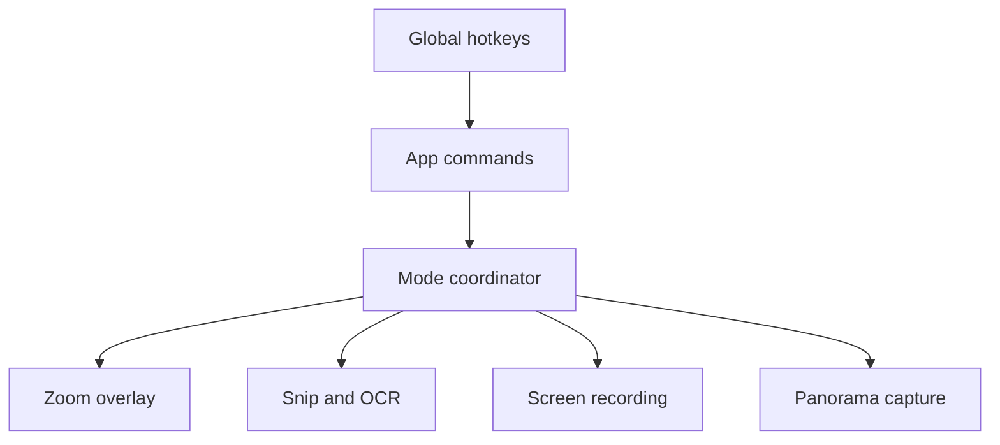

# microsoft/ZoomitForMac

> Utilitaire de barre de menus macOS pour zoomer, annoter, capturer et enregistrer l'écran, pour présentateurs.

## Le problème
Présenter ou documenter à l'écran sur Mac demande zoom, annotations, captures et enregistrement dans un seul outil.

## Ce que ça fait vraiment
Zoom fixe ou en direct, dessin et texte, captures et découpes, OCR local (Vision d'Apple), minuteur de pause, enregistrement MP4 avec éditeur, webcam et panorama de défilement. D'après le code, un coordinateur de modes reçoit les commandes des raccourcis globaux et les route vers chaque fonction.

## Comment c'est branché


## Essayer
```sh
brew install --cask microsoft/sysinternalstap/zoomit
swift build
swift run ZoomItMacSelfTest
swift run ZoomIt
```

## Coût et pièges
Gratuit. macOS 14 minimum ; autorisation Enregistrement d'écran obligatoire, micro et caméra seulement pour ces options. Les builds locaux ad hoc portent l'identité « ZoomIt (Dev) » pour ne pas perturber les droits de l'app officielle.

## Ce que ce n'est pas
Pas un outil IA ni multiplateforme : macOS seulement.

## Alternatives
Aucune alternative nommée dans le README (il s'inspire de ZoomIt de Sysinternals sous Windows).

## Pour toi
À ignorer : utile pour des démos sur Mac, sans lien direct avec la data ou le MLOps.

