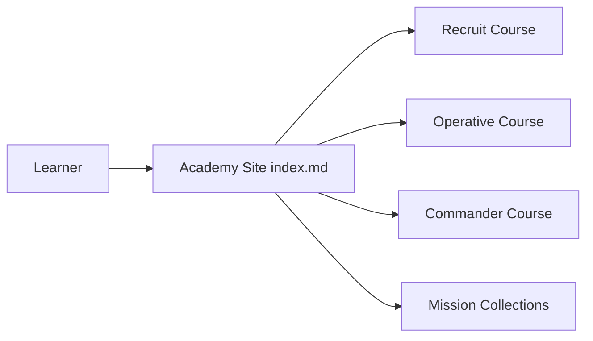

# microsoft/agent-academy

> Three-part Microsoft course to learn how to build agents with Copilot Studio.

## The problem
Beginners on Microsoft Copilot Studio have no guided path to build an agent.

## What it actually does
The README contains almost nothing: it announces a three-part course hosted at aka.ms/agent-academy. Judging by the repository structure, the site offers the Recruit, Operative and Commander courses (Nextgen/Preview versions), mission collections, events and product/industry pages.

## How it is wired

## Trying it
No command: the content is read at https://aka.ms/agent-academy. Command not documented in the README.

## Cost and gotchas
Assumes access to Microsoft Copilot Studio (license or trial); the README does not state the cost.

## What it is not
Not a tool or reusable code: a training site. Insufficient material in the README to go further.

## Alternatives
No alternative named in the README.

## For you
Ignore unless your team adopts Copilot Studio: it is proprietary training material, of no benefit to a data/AI profile outside the Microsoft ecosystem.
