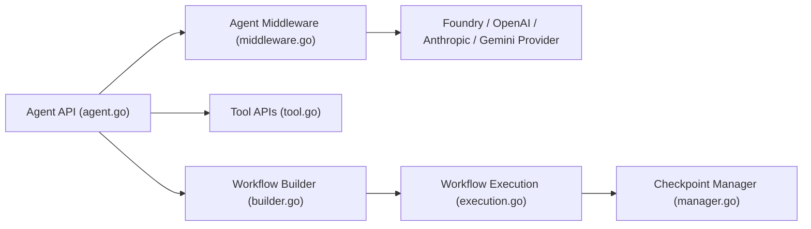

# microsoft/agent-framework-go

> Go implementation of Microsoft Agent Framework for agents and graph-based multi-agent workflows.

## The problem
An agent beyond a single prompt requires orchestration, recovery after failure, human oversight and observability.

## What it actually does
Agent API with sessions, middleware (logging, OpenTelemetry, tool approval), context compaction, OpenAI, Foundry, Anthropic and Gemini providers, tools (functions, MCP, shell), A2A and AG-UI interoperability. The workflow engine handles sequential, concurrent, conditional routing, checkpoints and external requests. Missing: declarative workflows, RAG, CodeAct, DevUI, handoff.

## How it is wired


## Trying it
```bash
go get github.com/microsoft/agent-framework-go
az login
```
The quick start sets `FOUNDRY_PROJECT_ENDPOINT` and `FOUNDRY_MODEL`.

## Cost and gotchas
The README announces a public preview, evolving outside the main repository. You need a provider endpoint (Foundry, Azure OpenAI, OpenAI…) and your credentials. The README warns that third-party systems are your responsibility (data, costs).

## What it is not
Not at parity with the .NET version: several features are not implemented in Go. No Microsoft telemetry by default.

## Alternatives
- .NET and Python implementations of the upstream Microsoft Agent Framework repository: more features.

## For you
Worth watching if you work in Go and in the Microsoft ecosystem: a good orchestration framework, but an incomplete preview compared with the Python and .NET versions.
