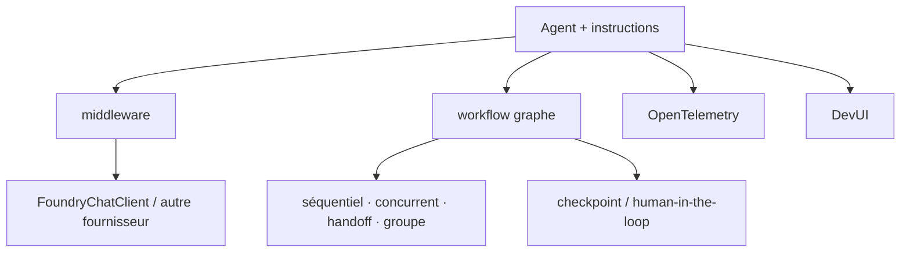

# microsoft/agent-framework

> Microsoft's multi-language framework for agents and multi-agent workflows in .NET, Python and Go.

## The problem
Going from an agent prototype to an operable system requires durability, recovery after failure,
observability and human control — which a stateless chat loop does not provide.

## What it actually does
MAF offers consistent APIs across Python and C#/.NET (the Go SDK lives in
`microsoft/agent-framework-go`), a middleware system for request/response processing, and
graph-oriented workflows: sequential, concurrent, handoff, group collaboration, with
checkpointing, streaming, human-in-the-loop and time travel. It also adds declarative agents in
YAML, Agent Skills, Foundry hosting in two lines, a debugging DevUI, native OpenTelemetry
observability, and migration guides from Semantic Kernel and AutoGen.

## How it is wired


## Trying it
```bash
pip install agent-framework
```
```bash
dotnet add package Microsoft.Agents.AI
dotnet add package Microsoft.Agents.AI.Foundry
dotnet add package Azure.AI.Projects
dotnet add package Azure.Identity
az login
```

## Cost and gotchas
The framework is open, the models are not. The default path goes through Microsoft Foundry / Azure
OpenAI: `az login`, `FOUNDRY_PROJECT_ENDPOINT`, `AZURE_AI_PROJECT_ENDPOINT`. `DefaultAzureCredential`
is convenient in development but the README recommends an explicit identity in production, to
avoid latency and credential probing.

## What it is not
It is not cloud-neutral: provider flexibility is advertised, but the examples
and hosting revolve around Azure. Microsoft states that any use of third-party systems
(servers, agents, non-Azure models) is at your own risk, under their own licenses, and that it is
up to you to add your own security and content safeguards.

## Alternatives
The README does not compare, but documents migration from Semantic Kernel and from AutoGen —
the two Microsoft predecessors that MAF replaces.

## For you
The natural candidate if your company is already on Azure; otherwise the Foundry lock-in weighs more than
the workflow graph brings.
