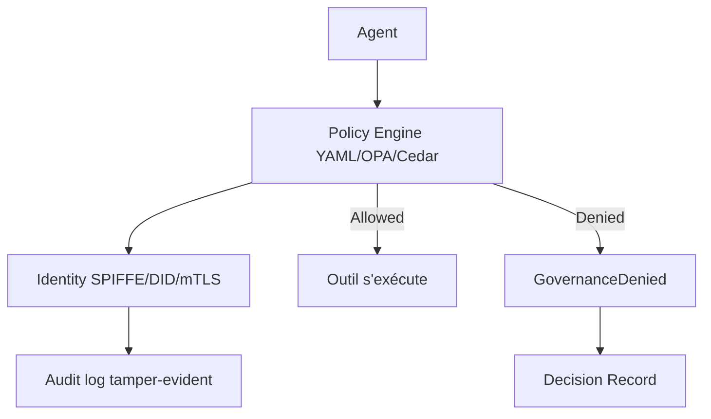

# microsoft/agent-governance-toolkit

> Multi-language toolkit for governing AI agents: policies, identity, sandbox, audit.

## The problem
Once deployed, agents decide on their own: tool calls, DB queries, delegation. Three questions remain: is the action authorized? which agent did it? can it be proven? Prompt-level security is not a control surface (100% attack success reported on GPT-4o, Claude 3, Llama-3).

## What it actually does
Intercepts every tool call, message send and delegation in deterministic application code **before** the model's intent reaches the network: denied actions are structurally impossible. `govern(my_tool, policy="policy.yaml")` checks, logs and raises `GovernanceDenied`. YAML/OPA/Cedar policies, SPIFFE/DID/mTLS identity, tamper-evident audit. Python SDK (full stack), TypeScript, .NET, Rust, Go. Four-ring privilege sandboxing, kill switch, MCP Security Gateway. 992 conformance tests.

## How it is wired


## Trying it
```bash
pip install "agent-governance-toolkit[full]"
```
```bash
agt doctor
agt red-team scan ./prompts/ --min-grade B
```

## Cost and gotchas
Free. Public Preview: breaking changes possible before GA. Python 3.10/3.11+ depending on the module. Governance at the application middleware level, **not** OS kernel: containerizing each agent is recommended. v4 to v5 migration required (ACS). Optional Azure features (credentials).

## What it is not
Not a prompt-level defense: deterministic control in code. Not OS isolation: to be complemented with containers.

## Alternatives
Not named as substitutes (integration examples: OpenAI Agents SDK, CrewAI, smolagents).

## For you
Relevant if you deploy AI agents in production and must prove compliance (OWASP, EU AI Act, SOC2); worth following (Preview).
