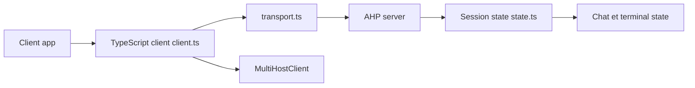

# microsoft/agent-host-protocol

> Synchronized state protocol between an AI agent session server and several clients.

## The problem
Several interfaces must display the same agent session without diverging state or coupling to a single editor.

## What it actually does
Defines a protocol (immutable state, pure reducers, write-ahead reconciliation) and publishes client SDKs: Rust, TypeScript, Kotlin, Go, Swift, .NET; some offer a `MultiHostClient`. State domains: root, session, chat, changeset, automation, terminal. Reference server: the VS Code agent host. The AHPX and VS Code clients exist.

## How it is wired


## Trying it
```bash
npm install
npm run docs:dev
npm run docs:build
```

## Cost and gotchas
Free. Each SDK follows its own SemVer; the specification is young (created in March 2026). The commands above only concern the documentation site.

## What it is not
Not an agent nor a standalone server: a specification and clients. The only reference server is in VS Code.

## Alternatives
No alternative cited in the README.

## For you
Worth watching: worth reading if you are building a multi-client agent interface; otherwise premature.
