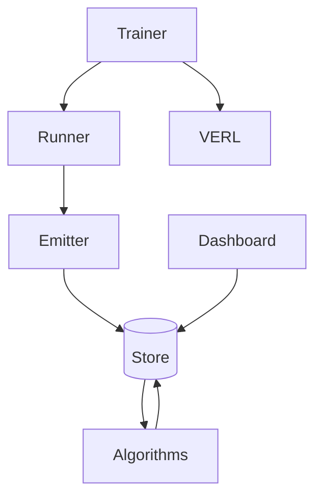

# microsoft/agent-lightning

> Trains existing AI agents with reinforcement learning, with almost no change to their code.

## The problem
Improving an agent with RL normally forces you to rewrite it to plug it into a training loop.

## What it actually does
An API proxy captures the real agent's model requests and converts them into training data. Three components: Trainer (verl and vLLM, builds samples, updates the policy), API Gateway, Rollout Controller (agents locally or as Kubernetes Jobs). A central store (memory, SQLite, MongoDB) links traces, resources and algorithms, and a React dashboard shows the state. The README announces gains on SWE-bench Verified with Qwen3.5.

## How it is wired


## Trying it
```bash
cd <this-repo>
uv sync
bash scripts/setup_verl.sh 0.8.0 cu130
```

## Cost and gotchas
Example install on a CUDA 13.0 machine: a GPU is essential for training. The coding examples assume heavy compute (9B to 35B models).

## What it is not
Not an agent framework: it trains agents designed elsewhere. The SWE-bench figures are the authors', not verified here.

## Alternatives
No alternative named in the README.

## For you
Worth watching: relevant if you do RL on agents and have GPUs; otherwise it is an architecture read more than a daily tool.
