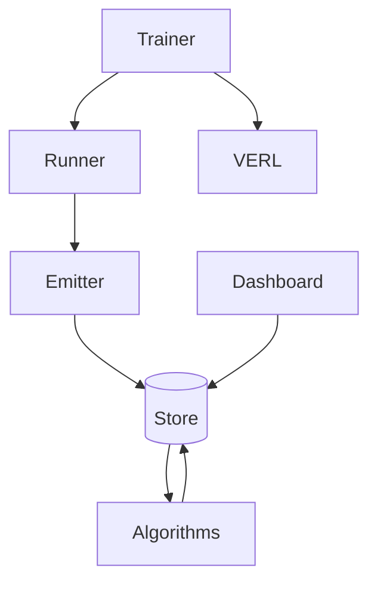

# microsoft/agent-lightning

> Entraîne des agents IA existants par apprentissage par renforcement, presque sans modifier leur code.

## Le problème
Améliorer un agent par RL oblige normalement à le réécrire pour le brancher à une boucle d'entraînement.

## Ce que ça fait vraiment
Un proxy d'API capture les requêtes modèle de l'agent réel et les convertit en données d'entraînement. Trois composants : Trainer (verl et vLLM, construit les échantillons, met à jour la politique), API Gateway, Rollout Controller (agents en local ou en Jobs Kubernetes). Un store central (mémoire, SQLite, MongoDB) relie traces, ressources et algorithmes, et un tableau de bord React affiche l'état. Le README annonce des gains sur SWE-bench Verified avec Qwen3.5.

## Comment c'est branché


## Essayer
```bash
cd <this-repo>
uv sync
bash scripts/setup_verl.sh 0.8.0 cu130
```

## Coût et pièges
Exemple d'installation sur une machine CUDA 13.0 : GPU indispensable pour l'entraînement. Les exemples de codage supposent du calcul lourd (modèles 9B à 35B).

## Ce que ce n'est pas
Pas un framework d'agents : il entraîne des agents conçus ailleurs. Les chiffres de SWE-bench sont ceux des auteurs, non vérifiés ici.

## Alternatives
Aucune alternative nommée dans le README.

## Pour toi
À surveiller : pertinent si tu fais du RL sur des agents et disposes de GPU ; sinon c'est une lecture d'architecture plus qu'un outil quotidien.

