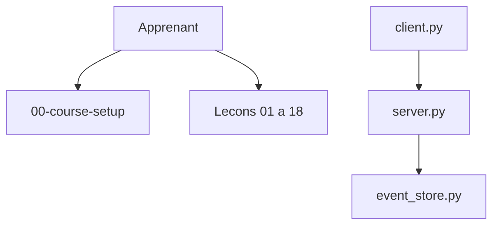

# microsoft/ai-agents-for-beginners

> Microsoft course in 18 lessons to learn how to build AI agents using Python.

## The problem
The agents combine tools, documentation, planning, memory, and protocols; without a clear understanding of the underlying patterns, they simply stack demos without grasping the bigger picture.

## What it actually does
Each lesson includes a README, a video, and Python examples using the Microsoft Agent Framework and Foundry Agent Service V2: agent frameworks, patterns, tool usage, RAG (Retrieval-Augmented Generation) agents, reliable agents, planning, multi-agent systems, metacognition, production, protocols (MCP, A2A, NLWeb), context, memory, computer-use agents, scaling, local agents, and security.

## How it is wired


## Trying it
```bash
git clone --filter=blob:none --sparse https://github.com/microsoft/ai-agents-for-beginners.git
cd ai-agents-for-beginners
git sparse-checkout set --no-cone '/*' '!translations' '!translated_images'
```

## Cost and gotchas
The examples require an Azure account and Microsoft Foundry; an alternative compatible with OpenAI (MiniMax) is mentioned for some cases. The process is resource-intensive due to the over 50 translations involved.

## What it is not
Not a framework for agents: only the client/server lesson protocol MCP is shared code; the rest is for educational purposes. Focused on the Microsoft ecosystem.

## Alternatives
No alternative is specified in the README (it refers to "Generative AI For Beginners").

## For you
This framework should be used to structure your understanding of agents (patterns, MCP, memory, security), while keeping in mind the Microsoft/Azure bias.
