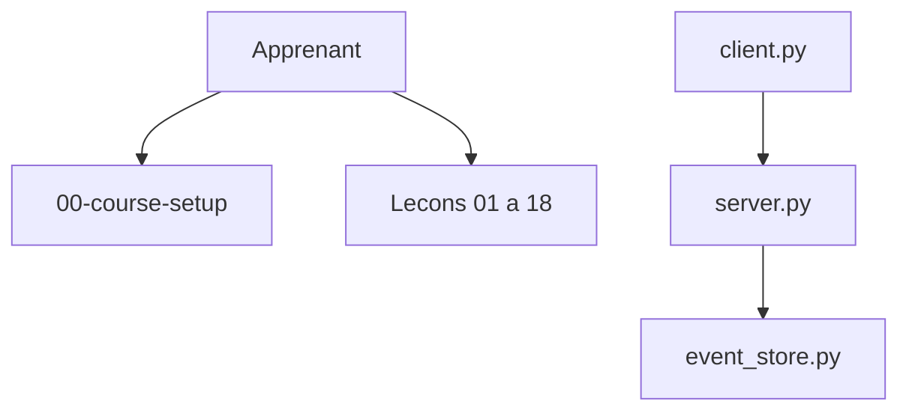

# microsoft/ai-agents-for-beginners

> Cours de Microsoft en 18 leçons pour apprendre à construire des agents IA avec Python.

## Le problème
Les agents mêlent outils, RAG, planification, mémoire et protocoles ; sans parcours, on empile des démos sans comprendre les patterns.

## Ce que ça fait vraiment
Chaque leçon propose un README, une vidéo et des exemples Python avec Microsoft Agent Framework et Foundry Agent Service V2 : cadres d'agents, patterns, usage d'outils, RAG agentique, agents fiables, planification, multi-agents, métacognition, production, protocoles (MCP, A2A, NLWeb), contexte, mémoire, agents d'usage d'ordinateur, passage à l'échelle, agents locaux, sécurité.

## Comment c'est branché


## Essayer
```bash
git clone --filter=blob:none --sparse https://github.com/microsoft/ai-agents-for-beginners.git
cd ai-agents-for-beginners
git sparse-checkout set --no-cone '/*' '!translations' '!translated_images'
```

## Coût et pièges
Les exemples requièrent un compte Azure et Microsoft Foundry ; une alternative compatible OpenAI (MiniMax) est citée pour certains. Dépôt lourd à cause des 50+ traductions.

## Ce que ce n'est pas
Pas un framework d'agents : seul le MCP client/serveur de la leçon protocoles est du code partagé ; le reste est pédagogique. Orienté écosystème Microsoft.

## Alternatives
Aucune alternative nommée dans le README (renvoie à Generative AI For Beginners).

## Pour toi
À adopter pour structurer ta compréhension des agents (patterns, MCP, mémoire, sécurité), en gardant en tête le biais Microsoft/Azure.

